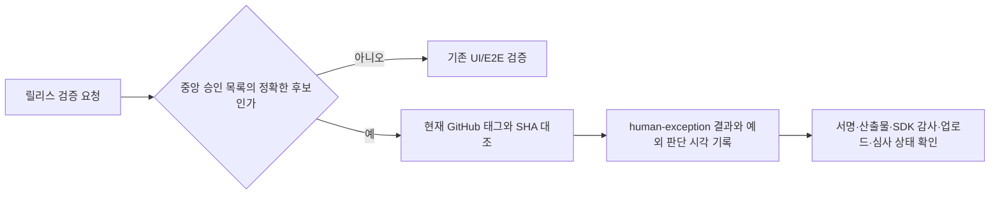

# Jomul v1.1.2 심사 제출 검증 예외

사용자가 2026-10-13에 중앙 검증 예외와 장비 검수 생략, Google Play·App Store 심사 제출을 명시 승인했다. 승인 근거는 [jomul #200](https://github.com/seorilabs/jomul/issues/200)이다. 제품 소스·태그는 유지한다.

승인 범위는 `seorilabs/jomul`, `v1.1.2`, `975d2e8c555bcb43f37a9034c881bfb17574cfea`, 두 마켓의 before-build/before-deploy다. 2026-10-20T08:42:25Z에 만료하고 두 마켓 접수 확인 뒤 승인 항목을 제거한다. 공개 출시는 승인 범위에 없다. UI 26 통과/4 차단, 별도 E2E 미실행, 실기기 생략은 검증 성공으로 바꾸지 않는다.

## 구현과 실패 처리

중앙에서 검토한 승인 기록만 읽고 일반 CLI/환경변수 생략 옵션은 추가하지 않는다. 후보·마켓·phase·시각이 다르면 기존 검증 경로를 쓴다. 실제 annotated tag를 읽고 commit SHA가 다르거나 조회에 실패하면 예외도 거절한다. 예외 결과는 `human-exception`, `productE2eStatus:blocked`와 승인 기록 ID를 출력한다. 이미 발급한 고정 태그의 호환 경로이며 두 마켓 제출 후 전용 승인 목록과 코드를 제거한다. 새로운 릴리스에는 최신 명시적 grant 경로를 쓴다. Xcode Cloud 기존 훅이 필요로 하는 `completed_at`은 E2E 완료/실제 예외 판단 완료 시각이며 실제 E2E 실행을 뜻하지 않는다. 기존 훅의 `--after`를 지원하고 시각 역전은 거절한다.

## 인수조건과 검증

1. 정확한 후보·두 마켓·두 phase만 승인 범위 안에서 예외 처리한다. 만료/다른 후보/다른 마켓은 예외가 없다.
2. 변경된 실제 태그·읽기 실패는 차단한다.
3. 실패·미실행 기록을 통과로 만들지 않고 정상 E2E 검증을 보존한다.
4. 기존 Xcode Cloud receipt 인터페이스와 배포 전 시간 대조가 동작한다.
5. 의미 있는 단위·통합·CLI 테스트, 전체 npm test, 독립 Claude 코드 리뷰와 required check 후 병합한다. 제품 UI 변경이 없어 새 UI 검수는 해당 없음이다.

중앙 승인 항목 삭제 또는 만료는 즉시 원래 검증으로 복귀한다. 관련 티켓: jomul #200. Version Impact: patch.
