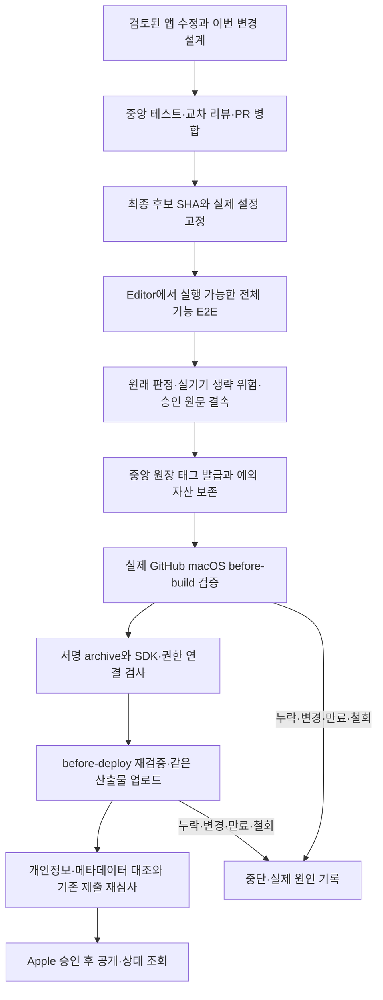

# 설계: Match Symbols iOS 1.1.7 실기기 검수 예외와 공개 진행

- 설계 ID: `MP-IOS-117-R1`, 버전: **v1**, 날짜: 2026-10-13.
- 상태: **대체됨** — 2026-10-14 [변경 등급별 테스트 계획](../2026-10-14-test-levels/design.md) 적용 때 예외 장치와 grant를 지웠다. 이전 상태: 중앙 변경 설계의 사람 검토 대기(실행 코드와 grant 변경 전).
- 중앙 기준: `4d862605add630da57ee1126d0bd95322fd343e6`.
- 제품 승인: `MP-IOS-117 v1`, 문서 커밋 `c92196fab6a302832c4919f71ff745cb3d280db6`; 사용자 답변 `v1 승인 — 수정·검수·재심사 진행`.
- 추가 요청 원문: `실 기기 검증 생략하고 바로 라이브 진행해`. 실기기 검수를 생략하고 App Store 공개까지 진행하는 운영 권한으로 기록한다. 이 문서의 중앙 코드·데이터 계약 설계 승인과 구분한다.
- 대상: `seorilabs/match-picture-app`, `v1.1.7`, App Store `1528539634`, bundle `com.github.magicsih.MatchSymbol`.
- 검토된 제품 후보: `f104d5dfae88dce5f51a6266dc40865cce74e9f0`; [앱 PR 113](https://github.com/seorilabs/match-picture-app/pull/113), [제품 티켓 112](https://github.com/seorilabs/match-picture-app/issues/112), [개인정보 페이지 PR 62](https://github.com/seorilabs/seorilabs-official/pull/62).

## 목적·범위·근거

현재 중앙 예외는 Reascend의 Firebase 설정·26기능·Xcode Cloud를 전제로 한다. 이 앱은 Godot 하위 프로젝트, GA4 Measurement Protocol 설정, 13기능, public GitHub macOS 빌드이므로 같은 grant를 사용할 수 없다. 1.1.7에만 별도 예외를 추가해 실기기 검수 생략을 검증 가능한 출시 판단으로 연결한다.

| 포함 | 유지할 조건 |
|---|---|
| iPhone/iPad 실기기 권한·광고·게임 검수 생략 | 미검증 판정과 위험 원문 보존; 실제 통과로 바꾸지 않음 |
| 중앙 grant의 별도 public Godot iOS 형식과 실제 CI 검증 | 저장소·태그·bundle·후보·설정·원문 승인·관측 원본·168시간 만료·철회 결속 |
| 기존 중앙 macOS workflow와 앱의 얇은 caller에 명시적 예외 입력 | 입력이 없으면 기존 E2E 검증 경로 유지; 자동 대체·skip 환경변수 없음 |
| 재심사와 승인 후 자동 공개 | 서명·SDK manifest·개인정보 공개·마켓 문구와 이미지·Apple 심사 유지 |

Android·AppsInToss 배포, 게임 규칙·저장 형식·광고 동의 동작, 다른 앱의 예외, 자격증명 발급·교체, 심사 예외 회신·외부 지원 연락은 포함하지 않는다. 공개 목표는 `public_live`이며 기존 `AFTER_APPROVAL` 설정을 현재 조회로 확인한 뒤 사용한다.

## 흐름·구조·책임

중앙에 기존 grant 형식과 분리한 `github-actions-godot-ios` 형식을 추가한다. 새 형식의 허용 범위는 위 저장소·태그·bundle·App Store 한 건으로 제한한다. 기존 Reascend 형식·Xcode Cloud 실행·26기능 검사는 그대로 유지한다. 새 형식은 후보 inventory 원문 전체 해시와 모든 항목의 `id/core/foundation/paths`를 비교하며 13항목을 누락할 수 없다.

중앙 검증기가 신뢰 기준을 소유한다. 앱 caller에는 `release_exception_id`, `configuration_fingerprint`, `release_verifier_sha`만 전달하는 입력을 추가한다. 재사용 workflow 호출은 조직 원칙대로 `@main`을 유지한다. 검증기 revision은 main에서 검토된 정확한 소스로 고정하고 실제 소스 bytes를 대조하며, 매 단계 최신 grant의 철회와 변경을 조회한다.

## 데이터·실패·품질

- 공개용 승인 receipt에는 실제 사용자 원문, 승인한 이 문서의 해시·커밋, 제품 승인, 대상·위험·만료를 담는다. 개인 경로·대화 식별자·비밀값은 넣지 않는다. 시각은 확인 가능한 수신 기록으로 구분하며 검수 실행 시각을 만들어 넣지 않는다.
- 제품 기준 tree는 검토된 후보로 고정한다. 그 뒤 허용하는 앱 변경은 `.github/workflows/deploy-app-store.yml`의 예외 전달과 승인 기록·출시 메타데이터를 명시한 정확한 경로뿐이다. 목록 외 코드·에셋·의존성·권한·광고·저장 파일 변경은 중단한다. 최종 source SHA와 원본 inventory는 태그와 일치해야 한다.
- 실제 입력은 Godot 4.7.2/stable, `godot` 프로젝트, `iOS` preset, bundle, Xcode 경로·scheme, exportOptions, 준비·export·검사 hook, 업로드 여부, 공개 저장소/macOS 경로와 결속한다. `godot/project.godot`, `export_presets.cfg`, 실제 사용하는 hook·네이티브 소스·SDK snapshot의 해시를 고정한다.
- GA4 설정은 기존 등록 identity와 소비 경로를 확인해 실제 CI에 전달되는 JSON bytes의 SHA-256을 관측한다. before-build는 실제 secret 입력의 해시와 형식을 확인하고, before-deploy는 실제 복원된 `godot/analytics.config.json`과 대조한다. 비밀값이나 값이 포함된 JSON은 로그·공개 자산에 넣지 않는다. secret 원본을 확인할 수 없으면 설정 검증을 생략하지 않고 중단한다.
- 공식 annotated tag receipt·release binding·encoded Apple build number를 사용한다. before-deploy에서 실제 최종 서명 앱의 Info.plist, bundle, marketing/build version, 기존 archive receipt 및 digest를 대조한다. Xcode Cloud의 `CI_BUILD_NUMBER`를 이 경로에 재사용하지 않는다. digest의 범위를 명시하며 Info.plist 해시를 전체 IPA 해시로 표현하지 않는다.
- 실제 CI run/attempt/job·검증기·두 단계 보고서·SDK 검사·산출물 receipt를 보존한다. 기존 서명 profile·framework·manifest·업로드 직전 산출물 재검사는 유지한다. 실행 입력 불일치, 원본 누락, 만료, 철회, 원격 조회 실패, SDK 변경, 서명·버전 불일치 때 중단한다.
- 예외 판정은 `decisionStatus: human_exception`, `productE2eStatus: blocked`다. Editor에서 확인한 범위와 iOS 미검증 범위를 각각 기록한다. 제품 UI 변경은 없으므로 이 중앙 작업의 UI 3회 검수는 해당 없다.

## 인수조건·테스트·남은 위험

| 조건 | 검증 |
|---|---|
| 다른 저장소·태그·마켓·bundle 또는 자동 fallback 거절 | 실제 production 검증기를 사용한 부정 테스트 |
| 승인·원본·inventory·제품 tree·설정·검증기·만료·철회 변경 거절 | 해시·Git tree·실행 입력 fixture와 원격 readback 경계 테스트 |
| before-build는 산출물 없이 성립; before-deploy는 실제 receipt와 서명 앱 요구 | 단계별 성공·누락·버전/digest 불일치 테스트 |
| 기존 일반 E2E와 Reascend grant 회귀 유지 | 중앙 전체 `npm test`, `npm run pack:check`, workflow 검증·actionlint |
| 예외를 PASS로 바꾸지 않음; 기존 3회 검수 원본 유지 | 결과 JSON과 원본 보고서 해시 검사 |
| 빌드 전 비실기기 E2E는 최종 후보·설정으로 실제 실행 | 기존 독립 검수자가 격리 Editor 실행, 범위·시작/종료·실패·재실행 증거 보존 |

요구사항 때문에 실패하는 테스트를 먼저 작성하고 최소 구현 뒤 회귀를 확인한다. 새로운 중앙/앱 릴리스 로직은 필수 Claude 읽기 전용 교차 리뷰와 Ready PR·CI·미해결 의견 0개를 거쳐 병합한다. 최종 Editor 검수는 새 UI 회차를 임의 추가하지 않고 기존 v1의 빌드 전 E2E 단계로 수행한다.

실기기에서 ATT/UMP 창 순서와 재진입, 거부/철회 후 광고 차단, 네이티브 bridge ABI·실제 광고, iPhone/iPad 입력·safe area·절전·Game Center는 확인되지 않았다. Editor 대체 구현과 자동 검사가 해당 위험을 완전히 해소하지 않는다. 사용자가 요청한 생략 범위로 명시하며 광고 수익 저하·실행 실패·재거절 가능성을 기록한다. Apple의 승인 전 공개 상태는 대기다.

## 적용·운영·복구·승인

설계 승인 뒤 중앙 구현/검토 → 앱 caller PR → 후보·설정 고정/Editor E2E → grant 원본 결속/중앙 검사 → 태그·빌드/업로드 → 정책 페이지 공개와 App Privacy 대조 → 기존 거절 버전을 1.1.7로 갱신하고 같은 review submission으로 재심사 → 승인/공개 readback 순서로 진행한다. 기존 1.0.4 공개 상태와 1.1.6 거절 이력은 현재 조회로 보존한다. 다음 단계의 같은 범위 승인 질문은 반복하지 않는다.

grant를 철회하면 pin된 검증기도 다음 단계에서 중단한다. 기존 정상 경로를 되돌리면 예외를 사용할 수 없다. 이미 공개된 앱 문제는 심사 철회/새 수정 버전 등 실제 마켓에서 가능한 조치로 대응하며 이전 버전으로 즉시 되돌릴 수 있다고 약속하지 않는다. 한 릴리스 완료 또는 최대 168시간 만료 후 예외를 닫는다.

이 문서의 정확한 커밋 승인 기록, 실행 티켓·PR·테스트·검증 보고서를 이후 연결한다. 현재 사용자의 실기기 생략 지시를 이 중앙 설계의 사전 승인으로 변조하지 않는다.
