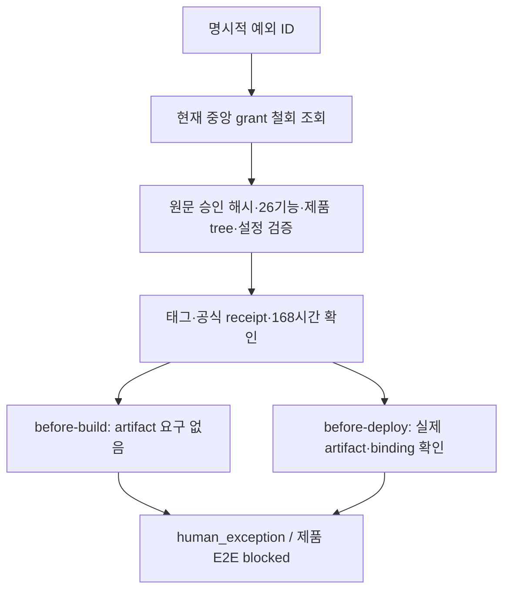

# Reascend 1.1.0의 사람 승인 출시 예외

2026-10-12T22:39:42.421196+00:00에 사용자가 다음 범위를 승인했다.

> 1.1.0 후보 전용 예외 설계와 중앙·앱 파이프라인 변경, 남은 미확인 위험까지 승인. 추가 결제 테스트 없이 빌드·심사·공개까지 진행해.

승인 설계 원문 SHA-256은 `a81b4a86f9b2bb17adb17dd2848c9d06bcf0ec3f02c3922f364f0d627d6dbd53`이다. [공개용 승인 receipt](../../../contracts/release-exceptions/reascend-1.1.0.approval.json)는 원문·시각·범위와 private 원본의 해시를 보존한다. 기존 [실행 티켓 seorilabs/reascend#506](https://github.com/seorilabs/reascend/issues/506)에 연결한다. 중앙 구현 기준은 최신 `48904de70de90628e4ebaa408f629bf5afe5702f`이며, 승인 당시 `992d2af` 이후 추가된 30일 기반 기능 근거 승계는 수정하지 않는다.

## 문제와 승인 범위

`0f6e2f8cc2e2e2524fc488e34e029af925151c53`의 native 인증·원격 계정 삭제·Main 저장/오류/재시작과 전체 26기능 E2E, Apple TEST HTTP404/token 없음·수신/환불 원장, 물리 결제 검증이 미확인이다. 기존 fixture PASS와 partial/unknown/blocked를 통과로 바꾸지 않고, 승인한 위험을 사람이 수용한 릴리스 판단으로 표현한다. 실제 전체 PASS 근거의 v1 schema와 정상 검증 동작은 유지한다.

중앙에 strict 별도 manifest schema·검증기와 검토된 grant를 추가한다. Reascend 앱은 `.github/workflows/deploy-google-play.yml`과 `xcode-cloud/ci_scripts/verify_development_evidence.sh` 두 파일만 바꿀 수 있다. 전체 제품 tree와 26기능 inventory가 기준과 같아야 하며 변경된 최종 SHA·마켓·설정·태그에 승인을 결속한다. 다른 후보·마켓·다음 릴리스 재사용은 금지한다.

## 구조와 실패 처리

별도 strict grant schema는 필수값과 168시간 상한을 검사한다. 기존 v1 `releaseExceptions`는 선택적 확장이며 정상 v1 근거 형식은 바꾸지 않는다.

검토된 중앙 grant가 승인 해시·설계·기준 SHA·허용 파일·원래 판정·위험을 고정한다. runtime manifest의 자기 선언만으로 사람 승인으로 인정하지 않는다. 각 phase에서 최신 main의 grant를 다시 읽어 철회와 핵심 변경을 확인하며 조회 불가·해시 변경·후보/설정/마켓/태그 불일치·168시간 만료·원본 판정 변조·누락은 중단한다. Git recursive tree가 잘렸거나 원본이 달라져도 중단한다.

UI8와 round7 최종 E2E 원본은 private 앱 Release의 고정 자산명으로 읽어 각각 기존 SHA-256과 대조한다. preflight도 원본 디렉터리를 필수로 받아 같은 검사를 한다. 공개 중앙 테스트는 격리 사본에 합성 fixture의 검토된 해시를 고정해 같은 production 검증기를 실행한다. 런타임에 신뢰 기준을 바꾸는 인자나 우회 코드는 추가하지 않는다.

태그 발급 전 local preflight는 `releaseBinding:null`로 실제 원격 소스 tree를 검사하고 `preflight_ready`만 출력한다. 이를 빌드 허가로 쓰지 않으며 CI 환경에서는 preflight를 거절한다. 실제 phase에서는 Release 자산과 annotated tag의 공식 receipt를 재조회한다. before-build에 아직 없는 artifact를 요구하지 않는다. before-deploy는 생성된 공식 binding과 실제 산출물 해시를 대조한다.

Reascend 기존 Apple helper는 중앙 `53c0819ec0976a48c7e8302234bcfc408f0a1e0b`에 고정돼 있으며, 실제 반환 `appleBuildNumber`의 정본은 `CI_BUILD_NUMBER`다. 태그 receipt의 encoded `appleBuildNumber`와 실제 archive 번호는 서로 다른 역할이다. 실제 archive는 그 고정 helper의 정확한 7필드 source/tag/marketing/runtime version/authority·applied binding과 실제 환경의 CI 번호, 최종 서명 앱 Info.plist를 대조한다. 버전 hook을 바꾸거나 현재 앱의 버전 경로를 이관하지 않는다. helper provenance는 보호된 소비자의 고정 선언이며 phase에서 이미 삭제된 helper bytes를 다시 읽었다고 하지 않는다. artifact digest는 최종 Info.plist 범위로 명시하고 전체 archive 해시와 구분한다.

## 리뷰 보강과 실행 범위

검증기 SHA 자기 선언을 제거한다. checkout은 실제 HEAD·직접 사용하는 tracked bytes, codeload archive는 GitHub 고정 revision의 같은 bytes를 독립 대조한다. 현재 main의 ancestor임을 확인하되 무관 main 변경은 허용한다. Android는 `release_verifier_sha`로 같은 authority를 고정하며 철회는 최신 main에서 매 phase 읽는다.

마켓별 지문은 실행자가 직접 관측한 v2 설정으로 고정한다. CI는 실제 package/track/status/upload·Godot·preset·scripts·analytics·Xcode scheme/project/tag 입력, 등록 Firebase bytes, 보호된 generator/build.env, AdMob env projection을 대조한다. before-build는 아직 준비 전이므로 같은 generator의 격리 예상 runtime 해시를 확인한다. before-deploy는 실제 runtime·Firebase 사본과 광고 주입 후 두 파일 해시를 확인한다. 운영 서버 snapshot은 중앙 CI의 새 권한 없이 실행자가 전후 재조회하며 이 부분을 CI의 fresh 조회로 주장하지 않는다.

Xcode trigger의 기동 전 검사는 ASC에서 실제 선택한 workflow/provider/tag ref와 공통 Release/source/승인 조건만 확인한다. `xcode-launch-request`와 `pending-ci-hook` 보고서는 실제 CI 판정을 대체하지 않는다. 외부 CLI skip flag와 가짜 CI env는 없으며 실제 Xcode hook에서 이 경계 사용을 거절한다. 실제 두 phase의 입력·runtime 검증은 유지한다.

Actions의 기존 3일 보존을 바꾸지 않고 private Release에 판정 보고서와 실제 CI의 원본 `promotion-evidence.zip`을 함께 보존한다. 미사용 승격 workflow는 확장하지 않는다. 공개 승격 전 `promotion-recheck`는 성공한 같은 원격 run/attempt/job·검토 workflow bytes·원격 job 로그의 ZIP/명세 SHA256·두 실제 CI 보고서·같은 AAB/receipt·최신 예외/태그/설정·실제 Play internal versionCode를 결속한다. 로컬 CI env 복제나 새 actual-ci-phase 판정은 금지한다. workflow의 main 실행 SHA와 검증기 pin SHA는 별도로 확인한다. pin checkout/npm 전에 main workflow 자체가 GitHub compare로 병합 ancestry를 확인한다. 이전 397/411개 검증은 이전 후보의 결과이며 이 수정 후 전체 검증으로 대체한다.

## 인수조건과 검증

- 일반 v1 및 30일 기반 기능 승계 검사 회귀가 통과한다.
- 승인·설계·원래 판정·inventory·제품 tree·마켓·태그·설정·검증기·만료·철회 불일치를 거절한다.
- before-build는 산출물 없이 성립하고 before-deploy는 실제 파일과 receipt 없이는 성립하지 않는다.
- iOS의 CI 빌드 번호와 encoded 태그 번호를 혼동하지 않는다.
- 결과는 `decisionStatus:human_exception`, `productE2eStatus:blocked`; E2E 통과 문구를 쓰지 않는다.
- Android의 두 gate와 Xcode trigger를 유지하며 판정 보고서를 보존한다. 정상 경로는 예외 입력을 사용하지 않는다.

실패하는 테스트를 먼저 실행한 뒤 최소 구현과 거절·회귀 검사를 작성한다. `npm test`, `npm run pack:check`, 전체 workflow `actionlint`, `git diff --check`를 실행한다. 제품 UI9·native/E2E·실구매·계정/저장 삭제는 0회다. 중앙 릴리스 코드의 필수 교차 리뷰와 PR/CI는 별도 절차이며 이 문서는 완료로 주장하지 않는다.

## 운영과 종료

공개 저장소에는 local home 경로·thread 식별자를 넣지 않는다. 마켓별 Release manifest, 공개용 승인 receipt와 위험 기록을 보존한다. before-build/before-deploy의 판정과 artifact digest를 출력한다. 실패하면 빌드/업로드를 중단한다. 오류 시 신규 판매를 차단하되 기지급 거래의 복구·지급은 유지한다. 예외 만료/철회 또는 한 릴리스 종료 시 해당 manifest를 닫고, 중앙 grant의 `revoked:true`는 pin된 검증기도 반영한다. 검증기 삭제나 임시 bypass를 만들지 않는다.

서명·판매자·계약·상품·가격/지급·국가 법규·등급·공시·심사·승인·공개·서버/상품/분석 조회는 면제하지 않는다. 실제 통과한 기반 기능은 영향 없는 담당 경로와 30일 조건을 만족하면 기존 계약으로 이어받는다. fake 결제나 미확인은 실제 구매 통과 근거가 아니다.
