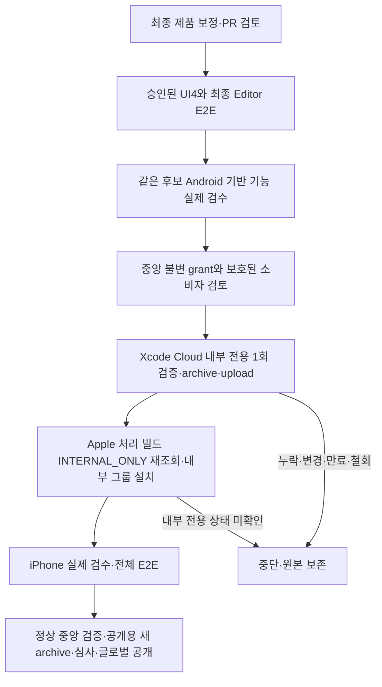

# 설계: Spiritgate 1.1.0 첫 내부 TestFlight 검수 순서

- 설계 ID: `SGD-TF-110-v1`; 중앙 기준 `a045805ea2b89e386533a621c5026996e15127a7`.
- 상태: 승인된 제안 범위의 구현 준비. [원본 제안](approved-proposal.md)과 [직접 사용자 승인](approval.json)을 보존한다.
- 최종 제품 SHA·설정 지문·공식 번호·실행 원본은 실제 검수 완료 후 결속한다. 값이 없으면 grant를 등록하거나 빌드하지 않는다.

## 목적과 범위

기존 App Store 프로필에는 USB 기기 설치 권한이 없다. 개발용 리소스를 생성하지 않고 iPhone에서 검수하려면 첫 내부 TestFlight 업로드가 필요하다. 이 한 건에 한해 iPhone 기반 기능 검수를 내부 설치 뒤로 옮긴다. 검수 면제와 공개 심사 예외는 없다.

대상은 `seorilabs/spiritgate-defenders`, 버전 `1.1.0`, ASC `6792205995`, bundle `com.seorilabs.spiritgatedefenders`, 기존 Xcode Cloud product `E5C1A24C-AA05-41B0-B2F6-F1BF0B92D7DB`와 workflow `45B83B98-ABE4-48C1-83FC-09CF3F79651E`이다. 같은 제품 후보 한 개·빌드/업로드 한 개·최대 168시간만 허용한다. 새 bundle/profile/certificate, Android 배포 예외, App Review/외부 TestFlight/공개 배포 예외는 없다.

원래 UI3의 비네이티브 통과 전제는 추가 UI4 승인의 범위에서 최종 독립 검수로 충족한다. UI1·2·3 실패/부분/미실행과 UI3 취소 미관찰은 그대로 보존한다. UI4 실패를 과거 제한 관측으로 대신하지 않는다.

## 흐름과 책임

중앙에 기존 공개 예외와 분리한 내부 검수 시점 예외를 둔다. 명시적 ID를 제공했을 때만 해당 중앙 grant를 조회한다. 정상 검증 실패를 자동 우회하지 않는다. 제품 연결부는 실제 Xcode Cloud의 workflow/product/build/source/tag와 설정을 중앙에 전달하며 판정을 직접 만들지 않는다. 정상 공개 경로는 그대로 유지한다.

## 데이터와 실패 처리

- 중앙 reviewed grant는 승인 원문·제안·기능 inventory·실제 관측 원본 해시·최종 제품 tree·허용된 연결부 변경 bytes·설정 지문·공식 태그/번호·만료를 결속한다. 코드/아트/저장/SDK/설정 변경은 후보 재사용을 차단한다.
- 실제 비네이티브 UI4 기능·UX와 Editor E2E의 전체 기능 범위, 같은 후보 Android 실기기 기반 기능을 요구한다. iOS 네이티브만 `deferred`로 남긴다. Editor 모의를 iPhone 통과로 바꾸지 않는다.
- before-build와 before-deploy는 중앙 소스의 실제 bytes와 main 병합 여부, 최신 중앙 grant의 존재/철회/불변 해시, 같은 제품/설정/빌드 결속을 각각 검증한다. 조회 실패는 차단이다.
- 실제 Apple API로 기존 app/product/workflow, 단일 필수 iOS archive action의 `buildDistributionAudience: INTERNAL_ONLY`, 자동 시작 없음과 수동 태그를 재확인한다. 실제 CI_BUILD_ID의 source commit·product·workflow·number를 대조한다. 자체 입력 `internalOnly=true`나 환경변수 주장만으로 통과시키지 않는다.
- Apple 공식 OpenAPI 4.5.1은 `BuildAudienceType`을 `INTERNAL_ONLY` 또는 `APP_STORE_ELIGIBLE`로 정의한다. 최종 처리된 `Build.attributes.buildAudienceType`이 `INTERNAL_ONLY`여야 내부 그룹에 연결한다. 공개 버전·외부 그룹·심사 연결은 이 경로에서 수행하지 않는다.
- before-deploy는 실제 최종 서명 앱·Info.plist 버전/bundle·profile·SDK/권한·privacy manifest·산출물 해시와 공식 번호를 검사한다. 두 단계 보고서와 공급자 build ID를 durable draft 근거 보관함에 보존한다.
- 한 번의 공식 빌드 ID를 grant에 고정한다. 실패/시간초과 후 상태 조회를 먼저 하고 임의 재시작/다른 빌드 ID로 대체하지 않는다.
- 결과는 `decisionStatus: human_exception`, `productE2eStatus: blocked`, `scope: internal_testflight_only`로 유지한다. 공개 정상 검증기와 심사 제출 경로는 이 결과를 받지 않는다.

## 품질·대안·보안

API/JWT와 기존 GitHub 실행 자격증명은 등록된 identity를 재사용한다. 값은 메모리에서만 다루고 diff·로그·영수증·공개 grant에는 해시/공개 key ID만 남긴다. 환경 연결 전 기존 credential 백업·두 저장소 복원 검증을 요구한다. provider 계정/리소스가 다르거나 로그인 연결이 없으면 독립 작업을 계속하고 해당 변경을 보류한다.

새 개발 프로필은 사용자 지시로 제외한다. 기존 App Store 프로필의 USB 설치를 시도하지 않는다. 일반 공개 예외로 네이티브 검수를 생략하는 대안도 제외한다. Apple의 내부 전용 빌드는 공개 제출에 사용할 수 없으므로 실제 iPhone/정상 E2E 완료 뒤 같은 검증 제품 소스로 공식 새 build number를 배정한 공개용 archive가 필요하다. 두 산출물을 혼용하지 않는다.

## 인수조건과 검증

| 조건 | 관찰할 동작·검증 |
|---|---|
| AC1 범위 제한 | 다른 repo/version/bundle/market/candidate/build ID/phase/intent, 외부 그룹·심사·공개 목표를 거절 |
| AC2 승인·원본 보존 | grant/승인/원본/inventory/tree/configuration/verifier 변경·만료·철회·조회 실패를 거절; 기존 unknown/blocked 판정 그대로 유지 |
| AC3 선행 검수 | 실제 UI4/Editor 전체 범위·시간 순서·독립 검수·Android 기반 기능 누락/실패/만료는 거절; iOS 외 deferred는 거절 |
| AC4 내부 전용 | live Apple app/product/workflow/build 불일치·APP_STORE_ELIGIBLE·추가 action·자동 시작은 거절; 처리 후 INTERNAL_ONLY 확인 전 그룹 배포 차단 |
| AC5 산출물 | before-build 산출물 불필요, before-deploy 실제 서명·버전·profile·SDK·privacy·digest·같은 빌드 영수증 필수 |
| AC6 정상 경로 | 정상 E2E·기존 공개 grant 회귀 유지; 내부 예외 결과로 정상 공개/심사 gate 통과 불가 |

의미 있는 부정/경계 테스트를 먼저 실패시킨 뒤 최소 구현한다. 중앙 전체 `npm test`, `npm run pack:check`, 해당 workflow/actionlint와 앱 연결 검사·cross-model 리뷰를 통과한다. 중앙/연결부는 제품 화면을 바꾸지 않아 별도 UI 회차가 필요 없다. 제품 검수는 승인된 UI4 한 회차만 실행한다.

## 적용·운영·복구·추적

중앙·제품 Ready PR은 새 PR마다 승인된 제한 Claude 리뷰 최대 2회와 필수 검사를 거친다. 불완전한 실제 실행을 통과한 fixture로 대체하지 않는다. grant 최종 값은 실제 최종 관측 후 검토해 등록한다. 이 문서는 아직 grant/정상 검증 통과/빌드/업로드 근거가 아니다.

grant 철회나 만료는 다음 단계 사용을 막는다. 기존 workflow의 APP_STORE_ELIGIBLE 설정 원본을 보존하고 내부 검수 종료 뒤 정상 공개 build 전에 승인된 기존 경로로 복원·재조회한다. 실패한 내부 업로드를 공개로 승격하지 않는다. 최종 iPhone·정상 전체 E2E·심사·글로벌 국가 확대·store 설치/업데이트 실제 실행은 모두 남은 완료 조건이다.

공식 근거: [Apple audience](https://developer.apple.com/documentation/appstoreconnectapi/buildaudiencetype), [OpenAPI](https://developer.apple.com/sample-code/app-store-connect/app-store-connect-openapi-specification.zip), [TestFlight 내부 검사](https://developer.apple.com/help/app-store-connect/test-a-beta-version/add-internal-testers), [Xcode Cloud 환경](https://developer.apple.com/documentation/xcode/environment-variable-reference).
