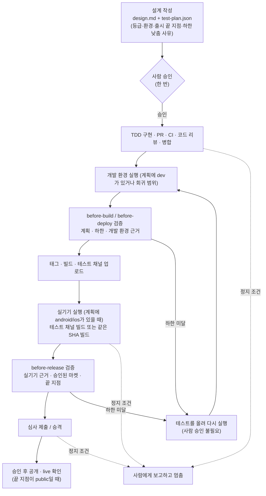

# 설계: 변경 등급별 테스트 계획과 앞단 승인

- 설계 ID·버전: `2026-10-14-test-levels`, v1
- 상태: 승인 (2026-10-14, 아래 [승인·추적](#승인추적))
- 중앙 기준: `9e61d5cf` (origin/main)
- 대화 결정(2026-10-14): 등급에 검수 방식 묶기, 자동 하한과 설계에서 낮추기, 설계에 끝 지점 명시(기본 공개), 기존 예외 장치 즉시 삭제
- 대체 대상: [개발 워크플로우 v1](../2026-10-08-development-workflow/design.md)의 UI 3회·전체 E2E 규칙, [기반 기능 이어받기](../2026-10-12-e2e-foundation-carry-forward/design.md)(회귀 범위 안에서 유지), 2026-10-13 릴리스별 예외 설계 3건

## 목적·범위·근거

### 문제

| 지금 규칙 | 결과 |
|---|---|
| 변경 크기와 상관없이 독립 UI 검수 3회 + 구현된 **전체** 기능 E2E | iOS 동의 창 분기 하나를 바꿔도 13~26개 기능 전체를 3회 이상 다시 확인 |
| 실기기 확인이 필요한지 설계에서 정하지 않음 | 출시 직전에 실기기 미확인이 드러나 차단 |
| 막히면 릴리스 한 건 전용 예외(grant)를 중앙 계약에 추가 | 10/13 하루에 4건(Jomul 1.1.2, Reascend 1.1.0·1.1.1, Match Symbols 1.1.7). 예외 스크립트·스키마·grant·테스트 약 3,300줄 |
| 사람 확인 지점이 흩어짐 | 설계 승인 → 4회차 승인 → PR 병합 → 테스트 채널 정지 후 "심사 제출" → "공개 출시" → 예외 승인 |

### 결과

```text
지금   설계승인 ─ 구현 ─ 3회 검수 ─ 전체 E2E ─ 빌드 ─ [정지] ─ 제출 ─ [정지] ─ 공개
                          ▲4회차 승인     ▲막히면 예외 승인

변경 후 설계승인(등급·환경·출시 끝 지점 포함) ─ 구현 ─ 등급별 테스트 ─ 빌드 ─ 실기기(계획 시) ─ 제출 ─ 공개
        ▲사람 승인은 여기 한 번                        정지 조건이 생길 때만 멈춤
```

### 포함·제외

| 포함 | 제외 |
|---|---|
| 등급(L1~L3)·실행 환경·출시 끝 지점을 설계의 `test-plan.json`으로 정하고 사람이 승인 | 마켓 문구·이미지 검수, 서명·SDK·개인정보 검사, 마켓 심사 자체 |
| 검증기가 바뀐 파일로 최소 등급을 계산하고 계획과 대조 | TDD와 PR 코드 리뷰 규칙(현행 유지) |
| 실기기 실행 근거와 제출·승격 직전 검사 단계(`before-release`) | 결제 상품·가격·자격증명·파괴적 작업의 개별 승인(현행 유지) |
| 릴리스별 예외 장치 삭제와 진행 중인 Match Symbols 1.1.7 이관 | 이미 공개된 릴리스의 기록 변경 |
| `~/.agent` 지침·스킬 정렬 | 앱별 기능 목록의 `paths` 일괄 보강(앱별 후속) |

## 등급표

| 등급 | 테스트 범위 | 실행 환경 | 실행·검수 | 예시 |
|---|---|---|---|---|
| **L1** | 바뀐 기능만 | 개발 환경: Godot·Unity Editor, RN Web·개발 서버, 서비스 런타임 | 작성자가 직접 실행해 기록 | iOS에서 동의 창 표시 분기, 문구·수치 조정, 화면 하나의 버그 수정 |
| **L2** | 바뀐 기능만 | 실기기: Android 기본, iOS는 설계에서 선택 | 다른 에이전트가 플랫폼별 1회 | 광고·결제·권한 동작 변경, 네이티브 플러그인 설정 |
| **L3** | 바뀐 기능 + 전체 회귀 | 개발 환경 / Android / iOS / 둘 다 중 설계에서 선택 | 다른 에이전트 1회. 새 화면·UI 개편이면 3회 | SDK·엔진·의존성 업그레이드, 저장 형식 변경, 공통 구조 변경 |

- L3의 **기반 기능 전체 재확인**(`foundationRerun: true`)을 고르면 결제·광고·로그인·저장 같은 기반 기능도 이어받지 않고 실기기에서 다시 실행한다. 고르지 않으면 [영향 없는 기반 기능 이어받기](../2026-10-12-e2e-foundation-carry-forward/design.md)를 그대로 쓴다.
- 계획에 적은 환경마다 범위 안의 기능을 모두 실행한다. 예: L2 `["dev","android"]`이면 바뀐 기능을 개발 환경과 Android 실기기에서 각각 실행한다.
- 새 화면·UI 개편(`redesign: true`)은 L3 이상이며 기존 3회 검수(회차별 페르소나, 4회차는 사람 승인)를 유지한다. 3회차를 최종 후보 SHA에서 전체 기능으로 실행했으면 그 회차를 최종 회귀 실행으로 쓴다.

## 흐름



### 정지 조건

승인 뒤에는 아래 경우에만 멈춘다. 테스트를 **더 하는** 쪽(하한 상향, 환경 추가)은 묻지 않고 진행한다.

1. 테스트 실패를 승인 범위 안에서 고칠 수 없다(제품 동작·데이터 규약·구조·인수조건이 바뀌어야 함).
2. 검증기·required check·ruleset이 막는다. 우회하지 않는다.
3. 계획한 환경을 쓸 수 없다(예: iOS 실기기 없음). 계획을 낮추려면 다시 승인받는다.
4. 마켓 거절이 승인 범위 밖의 수정을 요구한다. 문구·메타데이터 같은 범위 안 수정은 고쳐서 다시 제출한다.
5. 새 화면·UI 개편 3회 뒤에도 미해결이다(기존 4회차 승인 규칙).
6. 기존 개별 승인 대상: 결제 상품·가격·정산, 자격증명 생성·교체, 데이터 삭제·복구, 보안 민감 변경의 교차 리뷰 불가, 지원팀 연락.

## 구조·책임

| 대상 | 책임 | 변경 |
|---|---|---|
| 앱 저장소 `docs/design/<id>/test-plan.json` | 승인받은 테스트 계획과 출시 범위 | 새 파일. 설계와 같은 커밋에서 승인 |
| 앱 저장소 `docs/qa/feature-inventory.json` | 기능 목록 | `schemaVersion: 1` 유지. 모든 기능에 선택 `paths`, 최상위 선택 `regressionPaths` 추가 |
| 중앙 `contracts/development-workflow.yaml` | 등급·하한·단계 계약 | `schemaVersion: 2`. `uiReview`·`editorE2e`·`releaseExceptions`를 `testLevels`·`floors`·`phases`로 교체 |
| 중앙 `contracts/test-plan.schema.json` | 계획 형식 | 새 파일 |
| 중앙 `contracts/development-evidence.schema.json` | 실행 근거 형식 | v2: `designs[]`, `runs[]`, `reviewRounds[]`. 기능 목록 복사본 제거 |
| 중앙 `scripts/release/verify-development-evidence.mjs` | 계획·하한·근거 대조 | v2 검증, `before-release` 단계 추가, 예외 경로 삭제 |
| 중앙 `promote-google-play.yml` | Play 승격 | `before-deploy` → `before-release` 검사 |
| App Store·AppsInToss 제출 | 에이전트 로컬 실행 | 제출 직전 `--phase before-release` 검증 실행(중앙 workflow가 제출하지 않음) |
| `~/.agent` 지침·스킬 | 실행 규칙 | 아래 [적용](#적용운영되돌리기) 참고 |

## 데이터·인터페이스·실패 처리

### test-plan.json

```json
{
  "schemaVersion": 1,
  "level": "L1",
  "baseline": "v1.1.6",
  "changedFeatures": ["interstitial-and-privacy"],
  "environments": ["dev"],
  "redesign": false,
  "foundationRerun": false,
  "floorOverrides": [
    { "rule": "foundation", "featureId": "interstitial-and-privacy",
      "reason": "iOS 표시 분기만 바뀌고 광고 SDK 호출 순서는 그대로다" }
  ],
  "release": { "markets": ["app-store"], "until": "public" }
}
```

| 필드 | 규칙 |
|---|---|
| `level` | L1: `environments == ["dev"]`. L2: android·ios 중 하나 이상(dev 선택). L3: 비어 있지 않은 아무 조합 |
| `baseline` | 대상 마켓의 현재 공개 버전 태그, 또는 전체 회귀를 통과한 마지막 릴리스 태그. 후보의 조상이어야 한다. 첫 출시는 `null`이며 L3만 허용 |
| `changedFeatures` | 기능 목록의 ID. 새 기능은 기능 목록에 먼저 추가 |
| `redesign` | `true`면 L3·3회 검수 |
| `foundationRerun` | L3에서만 `true` 가능. 기반 기능 이어받기 금지 |
| `floorOverrides` | 자동 하한을 낮춘 항목과 사유. 승인된 커밋의 파일에 있어야만 인정 |
| `release.until` | `test-track` / `review-submitted` / `public`. 생략하면 `public` |
| `release.rollout` | Play 단계적 출시 비율(선택). 생략하면 완전 출시 |

릴리스 후보에 승인 설계가 여러 개 묶이면 등급은 가장 높은 값, 기능·환경·마켓은 합집합, 끝 지점은 가장 이른 값으로 합친다.

### 자동 하한

검증기가 `baseline`부터 후보까지 바뀐 파일로 계산한다. 계획이 하한보다 낮고 해당 `floorOverrides`가 없으면 실패한다.

| 바뀐 파일 | 하한 | 낮추기 |
|---|---|---|
| 기능의 `paths` | 그 기능을 계획한 환경에서 실행 대상에 추가 | 해당 없음 |
| 기반 기능(`foundation: true`)의 `paths` | 그 기능을 **대상 마켓 플랫폼의 실기기**에서 실행(L2) | `{rule: "foundation", featureId}` |
| `regressionPaths`(없으면 중앙 기본값: 엔진·의존성·잠금 파일·네이티브 빌드 설정·export 설정·플러그인) | 전체 회귀(L3), 계획한 환경마다 | `{rule: "regression"}` |
| 비교 불가(기준이 조상이 아님, 300개 이상) 또는 `baseline: null` | 전체 회귀(L3) | `{rule: "regression"}`. 첫 출시는 낮출 수 없음 |
| `redesign: true` | L3·3회 검수 | 낮출 수 없음 |

플랫폼 연결: `google-play`→Android, `app-store`→iOS, `apps-in-toss`→Android 또는 iOS, `web`·`service`→실기기 없음.

### 실행 근거 v2

```json
{
  "schemaVersion": 2,
  "repository": "seorilabs/example", "sourceSha": "<40hex>", "target": "google-play",
  "productKind": "ui", "implementer": "agent-a",
  "designs": [{ "id": "EX-12", "document": "docs/design/2026-10-14-ex/design.md",
    "testPlan": "docs/design/2026-10-14-ex/test-plan.json", "approvedCommit": "<40hex>",
    "approverKind": "human", "approver": "…", "approvalEvidence": "…" }],
  "acceptance": [], "tdd": [],
  "reviewRounds": [],
  "runs": [
    { "id": "dev-1", "kind": "godot-editor", "sourceSha": "<40hex>", "executor": "agent-a",
      "plannedAt": "…", "startedAt": "…", "completedAt": "…",
      "scenarios": [{ "id": "S1", "featureIds": ["store"], "status": "passed", "evidence": ["…"] }] },
    { "id": "android-1", "kind": "android-device", "target": "google-play",
      "device": "Pixel 8 / Android 16", "build": "versionCode 21 internal",
      "configurationFingerprint": "<sha256>", "sourceSha": "<40hex>", "executor": "agent-b",
      "plannedAt": "…", "startedAt": "…", "completedAt": "…", "scenarios": [] }
  ],
  "carriedForward": []
}
```

### 검증기 판정

| 검사 | 오류 코드 |
|---|---|
| 각 `testPlan`을 `approvedCommit`에서 읽고 스키마 통과, `approvedCommit`이 후보의 조상 | `TEST_PLAN_UNAPPROVED`, `TEST_PLAN_INVALID` |
| 하한 계산과 계획 대조(낮춤은 승인된 사유만) | `TEST_LEVEL_BELOW_FLOOR <rule> <feature>` |
| 필요한 기능 × 환경마다 후보 SHA의 통과 시나리오, 168시간 이내 | `RUN_COVERAGE <env> <feature>`, `RUN_EXPIRED`, `RUN_CANDIDATE_MISMATCH` |
| L2 이상은 실행자 ≠ 구현자 | `INDEPENDENT_RUN_REQUIRED` |
| `redesign`이면 3회 검수(기존 회차 규칙) | `THREE_UI_ROUNDS_REQUIRED` 등 기존 코드 |
| 회귀 범위의 기반 기능 이어받기(기존 규칙, `foundationRerun`이면 금지) | 기존 `CARRY_FORWARD_*`, `CARRY_FORWARD_FORBIDDEN` |
| 실기기 실행의 `target`이 같고 지문이 주어지면 일치 | `CONFIGURATION_CHANGED` |
| `before-release`: 대상 마켓이 `release.markets`에 있고 끝 지점이 `test-track`이 아님, 실기기 근거 포함 | `RELEASE_NOT_AUTHORIZED`, `RUN_COVERAGE` |

| 단계 | 호출 위치 | 요구하는 실행 |
|---|---|---|
| `before-build`, `before-deploy` | 중앙 빌드·업로드 workflow, Xcode Cloud 훅 | 개발 환경 실행. 실기기 실행은 아직 없어도 됨 |
| `before-release` | Play 승격 workflow, App Store·AppsInToss 제출 직전 로컬 실행 | 계획의 모든 실행(실기기 포함) |
| `web`·`service`의 `before-deploy` | 공개 배포 workflow | 모든 실행(테스트 채널이 없음) |

Release 자산 이름은 지금 규칙에 `before-release`만 더한다. 나중 단계 자산이 없으면 앞 단계 자산을 읽는다(`before-release` → `before-deploy` → `before-build`).

### 과도기

- `schemaVersion: 1` 근거는 이 변경 병합 후 168시간 동안 기존 규칙으로 검증한다. v1 근거 자체가 168시간 뒤 만료되므로 그 시점(병합 + 7일)에 v1 분기를 지우는 PR을 올린다.
- 예외 장치는 이번 변경에서 삭제한다. 진행 중인 릴리스는 아래 이관을 먼저 끝낸다.

## 기존 예외 장치 삭제와 진행 중 릴리스 이관

| 릴리스 | 현재 상태(2026-10-14 조회) | 처리 |
|---|---|---|
| Reascend Android 1.1.0 (21) | production 승격 완료 receipt 있음 | 추가 검증 호출 없음. 기록만 보존 |
| Reascend iOS 1.1.1 | Release 자산 있음, App Store 업로드 상태 미확인 | 삭제 병합 직전 ASC에서 1.1.1 빌드 업로드 완료를 확인. 미업로드면 아래 Match Symbols와 같은 방식으로 계획을 승인받고 이관 |
| Match Symbols iOS 1.1.7 | 태그 전. 앱 caller PR #114가 예외 입력 사용 | 아래 계획으로 L1 이관 |
| Jomul 1.1.2 | 이미 예외 제거(중앙 PR #238) | 해당 없음 |

**Match Symbols 1.1.7 계획(이 설계 승인에 포함)** — 사용자의 2026-10-13 지시 “실 기기 검증 생략하고 바로 라이브 진행해”를 계획으로 옮긴다.

```json
{
  "schemaVersion": 1, "level": "L1", "baseline": "v1.1.6",
  "changedFeatures": ["interstitial-and-privacy"], "environments": ["dev"],
  "redesign": false, "foundationRerun": false,
  "floorOverrides": [
    { "rule": "foundation", "featureId": "interstitial-and-privacy", "reason": "사용자 지시로 iOS 실기기 확인 생략(2026-10-13). 기존 3회 Editor 검수 근거 유지" },
    { "rule": "foundation", "featureId": "native-leaderboards", "reason": "공통 설정 파일(export_presets.cfg·deploy-app-store.yml)만 겹침. 리더보드 코드 변경 없음" },
    { "rule": "foundation", "featureId": "analytics", "reason": "공통 설정 파일만 겹침. 분석 코드·설정 변경 없음, 출시 GA4는 비활성 유지" },
    { "rule": "regression", "reason": "export_presets.cfg·package.json·iOS 플러그인 추가. v1.1.6 후보가 기존 규칙의 전체 Editor 회귀를 통과" }
  ],
  "release": { "markets": ["app-store"], "until": "public" }
}
```

순서: 앱 PR(계획 파일 추가, caller의 예외 입력 제거) → 중앙 PR 병합 → 최종 SHA에서 L1 개발 환경 실행 → 태그·빌드·업로드 → `before-release` 검증 → 재심사 → 승인 후 공개. Reascend 앱의 예외 입력(`deploy-google-play.yml`, Xcode Cloud 훅)도 같은 방식으로 제거한다.

삭제 대상: `verify-release-exception.mjs`, `hosted-godot-ios-exception.mjs`, `verify-google-play-promotion.mjs`, `release-promotion-evidence.mjs`, `create-promotion-evidence.mjs`, 예외 스키마 3개, `contracts/release-exceptions/`, 예외 템플릿 2개, 관련 테스트, `godot-deploy-*`의 `release_exception_id`·`release_verifier_sha` 입력과 단계, `trigger-xcode-cloud.mjs`의 예외 분기, 실행 문서의 예외 절. 2026-10-13 예외 설계 문서는 기록으로 남기고 상태를 "대체됨"으로 바꾼다.

## 품질 요구사항

- 검증기는 지금처럼 GitHub contents·compare API만 쓰고 앱 소스를 실행하지 않는다. 계획 파일 2MB 상한.
- 근거·계획에 비밀값을 넣지 않는다. 설정 지문은 비밀값 없는 식별자의 SHA-256.
- 하한 계산은 결정적이어야 한다. 같은 입력이면 같은 결과.

## 대안·주요 결정

| 결정 | 선택 | 대안과 버린 이유 |
|---|---|---|
| 등급을 누가 정하나 | 에이전트가 하한표로 제안 → 사람이 설계에서 승인 | 검증기 자동 결정: 동의 창 예시처럼 사람 판단이 필요한 경우를 못 다룸 |
| 위험한 하향 방지 | 자동 하한 + 승인된 사유로만 낮춤, 착수 후 예상 밖 경로는 자동 상향 | 권고만: 실제 변경 파일과 등급이 어긋나도 못 잡음 |
| 실기기 실행 시점 | 테스트 채널 빌드에서, 제출·승격 직전 검사 | 빌드 전 로컬 빌드만: iOS는 서명 빌드 설치가 어렵고 실제 산출물이 아님. 같은 SHA 로컬 빌드도 허용 |
| 개발 환경 실행의 설정 지문 | 대상 마켓 실기기 실행에만 대조 | 개발 환경은 테스트용 대체 구현을 쓰므로 마켓 설정이 실행되지 않음. 현재도 일반 경로는 지문을 넘기지 않음 |
| 출시 승인 | 설계의 `release`가 배포 요청. 끝 지점까지 진행 | 단계마다 신호: 사람 확인이 흩어짐 |
| 예외 장치 | 즉시 삭제, 진행 중 릴리스는 계획으로 이관 | 유지: 같은 목적의 두 경로가 남음 |
| v1 근거 | 168시간 과도기 후 분기 삭제 | 즉시 거절: 진행 중인 다른 앱 릴리스의 근거를 모두 다시 만들어야 함 |

## 인수조건·테스트·검수

| ID | 통과 기준 | 테스트 |
|---|---|---|
| AC-1 | L1 계획 + 바뀐 기능 개발 환경 실행 + 작성자 실행이면 통과 | 검증기 단위 테스트 |
| AC-2 | 기반 기능 경로가 바뀌었는데 실기기 실행도 승인된 낮춤도 없으면 `TEST_LEVEL_BELOW_FLOOR` | 단위 |
| AC-3 | 같은 경우 승인 커밋의 `floorOverrides`가 있으면 통과. 승인 뒤 추가한 낮춤은 실패 | 단위 |
| AC-4 | `regressionPaths`·비교 불가·`baseline: null`이면 전체 회귀 요구, 낮춤 규칙은 위 표대로 | 단위 |
| AC-5 | L2 이상에서 실행자 = 구현자면 `INDEPENDENT_RUN_REQUIRED` | 단위 |
| AC-6 | `redesign: true`면 3회 검수 요구, L3 미만이면 계획 오류 | 단위 |
| AC-7 | `before-build`는 실기기 실행 없이 통과, `before-release`는 실기기 실행 없으면 실패 | 단위 |
| AC-8 | `before-release`에서 대상 마켓이 계획에 없거나 `until: test-track`이면 `RELEASE_NOT_AUTHORIZED` | 단위 |
| AC-9 | 설계 여러 개는 최댓값·합집합·가장 이른 끝 지점으로 합침 | 단위 |
| AC-10 | v1 근거는 기존 규칙으로 계속 검증 | 기존 회귀 테스트 유지 |
| AC-11 | 예외 입력·스크립트·스키마가 사라지고 중앙 workflow·Xcode trigger·repo-contract 테스트가 통과 | 전체 `npm test`, actionlint |
| AC-12 | `~/.agent` 지침이 등급제·앞단 승인·정지 조건과 일치하고 3회 일괄 규칙이 남지 않음 | 문서 검색과 스킬 검증 |

TDD: AC-1~AC-10은 실패 테스트를 먼저 작성한다. AC-11·12는 삭제·문서 변경이라 전체 테스트와 검색으로 확인한다. 이 변경은 정책·검증기 변경이므로 제품 UI 검수를 만들지 않는다.

## 적용·운영·되돌리기

| 순서 | 저장소 | 내용 |
|---|---|---|
| 1 | `seorilabs/.github` | 이 설계 커밋 → 등급제 계약·스키마·검증기·문서·템플릿, `promote-google-play` 단계 변경 (PR A) |
| 2 | `seorilabs/match-picture-app`, `seorilabs/reascend` | 계획 파일 추가(Match Symbols), caller·Xcode 훅의 예외 입력 제거 |
| 3 | `seorilabs/.github` | 예외 장치 삭제 (PR B, 2 병합 뒤) |
| 4 | `magicsih/agent-config` (`~/.agent`) | AGENTS.md, 개발·제품·작업 정책, `development-workflow`, `seorilabs-release-run`(정지 게이트 → 계획의 끝 지점, Discord 알림은 계획 승인에 포함), `multimarket-launch-completion`(승인 설계의 출시 범위를 배포 요청으로 인정) |
| 5 | `seorilabs/.github` | 병합 + 7일 뒤 v1 근거 분기 삭제 PR |

- 자율 이슈 처리: 승인된 계획의 `release`가 있으면 그 범위까지 진행한다(`approvalDoesNotAuthorizeRelease` 교체). 계획한 환경을 그 실행 환경에서 쓸 수 없으면 정지 조건 3으로 멈춘다.
- 교차 리뷰: 1·3은 릴리스 실행 로직 변경이라 Codex 교차 리뷰를 요청한다.
- 되돌리기: PR A를 revert하면 v1 규칙으로 돌아간다. PR B 이후의 되돌리기는 예외 장치 복원이 아니라 계획 재승인으로 대신한다.
- 운영 위험: L1 출시가 실기기 결함을 놓칠 수 있다. 하한표와 승인된 낮춤 사유로 범위를 제한하고, 낮춤 사유는 Release 자산의 근거에 그대로 남는다.

## 승인·추적

승인 요청 범위(한 번에):

1. 이 설계 v1과 위 순서 1~5의 구현.
2. Match Symbols 1.1.7 L1 계획(위 JSON)과 Reascend iOS 1.1.1 확인 절차.
3. 순서 1~5의 PR을 CI·교차 리뷰·미해결 thread 0 확인 뒤 병합.

승인 뒤 승인 문구와 커밋을 이 절에 기록하고 [설계 목록](../README.md)에 추가한다.

### 승인 기록

- 2026-10-14 17:20 KST 대화에서 사용자 승인: “승인”. 대상은 검토용 커밋 `7c117d4`의 이 문서(SHA-256 `81ac8d2d1cbceb794c128ad07f441e6b4fb2eaa38dd4755ba45208283ff492ec`)다. 최신 main 위로 옮긴 `9fcec84`도 같은 bytes다.
- 같은 대화의 범위 조정(승인 직후): Match Symbols는 그 저장소 세션이 진행한다. 이 작업은 앱 저장소(`match-picture-app`, `reascend`)를 바꾸지 않고 중앙 `.github`와 `~/.agent`만 진행한다. 위 Match Symbols 1.1.7 L1 계획은 승인된 계획 내용으로 남겨 그 세션이 사용한다.
- 순서 3(예외 장치 삭제)은 앱 caller와 Xcode 훅이 예외 입력을 쓰지 않게 된 뒤에 올린다. 그 전까지 예외 장치는 중앙에 남는다.

### 승인 후 확인한 상태 (2026-10-14 17:30 KST, App Store Connect 읽기)

| 릴리스 | 상태 | 이 설계에 주는 영향 |
|---|---|---|
| Match Symbols iOS 1.1.7 | 빌드 1001007 업로드 후 10/14 09:05 KST 심사 제출, 현재 버전 `INVALID_BINARY`·제출 `UNRESOLVED_ISSUES` | 기존 grant는 빌드 1001007에 묶여 있어 다음 빌드에 쓸 수 없다. 다음 후보는 위 L1 계획 경로를 쓴다 |
| Reascend iOS 1.1.1 | 빌드 18 업로드, `PENDING_DEVELOPER_RELEASE`(Apple 승인, 수동 공개 대기) | 업로드 완료. 이관 불필요 |
| Reascend Android 1.1.0 | production 승격 완료 | 기록만 보존 |
