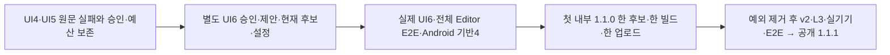

# Spiritgate UI6 승인과 과거 UI5 원문의 결속

- 설계 ID: `SGD-UI6-TF-110-v1`. 사람 승인: [원문](approval.json), [승인 당시 정확한 제안](approved-proposal.md). 제안 bytes의 당시 승인 대기 문구는 수정하지 않는다.
- 실행 티켓: [Spiritgate 전체 출시 #240](https://github.com/seorilabs/spiritgate-defenders/issues/240), [중앙 실행 범위](execution-ticket.md). 기존 [UI5 설계](../2026-10-14-spiritgate-ui5/design.md)를 이어간다.

## 문제·흐름·책임

UI5는 A7 후보에서 환경 오류와 누락 화면으로 실패했다. 실제 코드 결함 수정 후 새 후보에서 승인된 UI6을 검수하므로, UI5 원문을 새 후보로 소급 변경하면 안 된다. 중앙 검증기는 기존 4/5회 동작을 유지하고 별도 6회만 추가한다.

## 데이터·검증·실패

| 구간 | 결속과 실패 처리 |
|---|---|
| 기존4/5 | 기존 source/config 동등성과 승인 hash·시점·예산 검증을 그대로 유지한다. |
| UI6 | grant의 별도 UI6 승인 파일/hash, 정확한 제안 bytes, 현재 source/config를 대조한다. UI6 승인에 원래 시점 예외와 UI5 승인·source snapshot·configuration bytes hash를 연결한다. |
| 과거 UI5 | UI5 원문 승인/proposal을 변경하지 않는다. grant의 historical snapshot에 A7 source와 실제 개발 설정 지문을 고정하고 원격 보존 자산 bytes를 읽어 hash를 대조한다. source snapshot의 source와 설정 projection의 source/sourceAfter/fingerprint 및 5회 기록 source가 같아야 한다. UI5 승인 원문의 미확정 null source/config는 미등록 승인 상태로 보존하며 실제 snapshot을 대신하지 않는다. |
| 시간·예산 | 4·5·6회 각각 본180분+문제 재확인 단1회30분·합산210분 상한을 유지한다. 과거 승인 시각은 바꾸지 않고 5/6회마다 자신의 계획 전 승인이 있어야 한다. 최초 만료2026-10-20T23:16:52.580641Z와 v1 접수 종료2026-10-22T00:00:00Z를 연장하지 않는다. |
| 경계 | UI6 최신 기능/UX와 실제 전체 Editor E2E·동일 후보 Android 기반4는 계속 필수다. 기존 실패는 해결 근거와 함께 남긴다. iPhone은 내부 설치 뒤 검수 시점만 이동하며 면제하지 않는다. |

서명·기존 프로덕션 profile·INTERNAL_ONLY·철회 확인·정상 v2/L3 검증·공개 범위를 변경하지 않는다. 무제한 회차 지원, UI7, 실패를 PASS로 치환하는 방법은 제외한다. 기존 UI4/5 원본 파일은 수정하지 않는다. 새 grant나 실제 PASS를 만들지 않으며 registry는 비워 둔다. 실제 후보/설정/자산 ID가 확정되면 별도 검토된 등록이 필요하다.

## 인수조건·테스트

- AC-6-1: 정확한6회와 UI6 별도 승인·제안·현재 후보/설정·과거 snapshot 결속은 허용한다.
- AC-6-2: 누락/변경된 UI5 원문·제안·snapshot·후보/설정 또는 UI6 승인을 거절한다. 기존4/5 source/config 거절은 유지한다.
- AC-6-3: 4/5/6회 기록 누락·마지막 기능/UX 실패·각210분 초과·원래 기한 연장·UI7·Android 미검수·공개 사용을 거절한다.
- AC-6-4: 현재 main의 승인/proposal/snapshot hash·철회 확인과 검토된 verifier bytes 검사를 유지한다.
- [테스트 계획](test-plan.json)은 중앙 검증기 변경만 L1/dev로 검증한다. service/public은 중앙 계약의 PR 반영을 뜻하며 제품 마켓 공개 승인이나 실행 근거가 아니다. 중앙 계약 변경에 가짜 제품 실행 기록을 붙이지 않는다. 제품 전체 출시는 기존 승인 v2·L3 계획을 유지한다.
- TDD: 요구사항으로 실패하는6회 허용 RED 후 최소 구현, 거절 조건 회귀, 전체 중앙 npm test와 pack:check·diff 검사를 실행한다. 실제 기기/UI 검수는 별도 제품 실행자가 수행한다.

## 적용·운영·승인

기존 latest main에서 isolated feature 브랜치 → TDD → 한국어 Ready PR → 필수 검사·제한 Claude 읽기 전용 코드 diff 리뷰 → 병합 순으로 진행한다. 리뷰 전송은 자격증명·PixelLab 원본·개인정보·실행 로그를 제외하며 자동 Copilot 포함 총2회 이하다. 첫 내부 완료 후 제품 예외 인자를 제거하고 새 공개1.1.1 후보에서 v2·L3 검수로 진행한다. 검수/기한/서명 차단은 근거를 남기고 빌드를 시작하지 않는다. 되돌리기는 별도 PR이며 기존 원문과 실패 기록은 유지한다.
