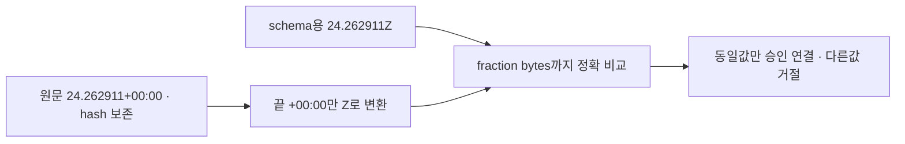

# UI5 승인 원문의 UTC 표기 호환 보정

- 기존 승인 범위: [UI6 설계](design.md), [승인 원문](approval.json), [정확한 제안](approved-proposal.md), [L1/dev 중앙 테스트 계획](test-plan.json).
- 연결 티켓: [Spiritgate 전체 출시 #240](https://github.com/seorilabs/spiritgate-defenders/issues/240). [중앙 PR252](https://github.com/seorilabs/.github/pull/252)은 병합된 과거 검토이며2/2회 상한을 다시 사용하지 않는다.
- 기준: 중앙 main729f4d975014e97e7ff5e4a687327bc5261b0d1f. 제품 후보/실제 UI6와 별도인 중앙의 원문 보존·최소 보정이다.

## 실제 결함과 제한된 동작

UI5 원문 approvalRecordedAt은 `2026-10-14T10:56:24.262911+00:00`이다. v1 Editor additionalIterationApprovals.approvedAt schema는 UTC Z만 받는다. 원문 표기를 그대로 넣으면 schema가 거절하고, 같은 fractional bytes의 `2026-10-14T10:56:24.262911Z`로 표현하면 bootstrap의 문자열 동등성 검사가 거절한다. 따라서 원문을 보존하며 실제 UI5 승인을 결속할 수 없다.

끝의 `+00:00`만 `Z`로 바꾸어 UI5 Editor 승인 시각을 대조한다. Date.parse/toISOString으로 fraction을 밀리초로 자르지 않는다. 이미 Z인 기존 입력은 그대로 유지하고, 다른 offset·다른 시각·마이크로초 한 자리 차이·fraction 절삭/추가를 허용하지 않는다. 원문 파일/hash·실제 승인 순간·회차/예산·원래 expiry·후보/설정/서명·v2/L3·최신 grant 철회 검증은 바꾸지 않는다.

## 인수조건·검증

- TZ-1: 실제 canonical UI5 receipt의 원문 +00:00과 같은 fraction의 schema용 Z가 보정 전 요구사항 때문에 실패하는 RED를 보존한다. 기존5회/새6회 둘 다 확인한다.
- TZ-2: 정확히 같은 UTC fraction만 연결하며 microsecond 마지막 한 자리 차이·절삭·확장·다른 offset은 TESTFLIGHT_UI5_EDITOR_APPROVAL로 거절한다.
- TZ-3: canonical approval/proposal bytes, 원래 만료와 정책 파일, grant registry 빈 값이 변경되지 않는다. 기존 전체 중앙 회귀를 통과한다.
- 중앙 변경은 기존 L1/dev 테스트 계획의 TDD·전체 회귀로 검증한다. 제품 UI6/E2E/기기 실행을 대신하는 기록을 만들지 않는다.

기존 사용자 UI6 중앙 최소 보정·원문 보존 승인의 적용을 부모가 확인하고 이 한정 보정을 지시했다. 새로운 사람 승인·기간 연장·회차 추가를 만들어 기록하지 않는다. 새 feature 브랜치에서 설계 보충→실제 RED→한정 변경→GREEN/전체 회귀→정확한 diff를 부모에게 전달한다. 부모의 최종 확인 전 PR·외부 Claude 전송·추가 리뷰·grant 등록·번호/태그/빌드는 수행하지 않는다. 실제 등록 PR과 이 과거 결함을 혼합해 #252에3차 리뷰를 붙이지 않는다.
