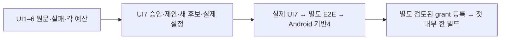

# 승인된 UI7을 UI6 원본 실패와 구분해 검증한다

상태: 사람 승인 범위 기록. [정확한 제안](approved-proposal.md) SHA256 `7d912748e44416e4a14d702909509206857d71c781dd2a168aada97a850af0a7`과 [사람 승인 원문](human-approval.json) SHA256 `d864eac9157b66d4718419e282b75399fa7ae15feca3e71f8c48374fe841d070`을 그대로 보존했다. 승인 시각은 `2026-10-15T09:24:12.777309+00:00`이다. 연결 티켓은 [Spiritgate #240](https://github.com/seorilabs/spiritgate-defenders/issues/240)이다.

## 범위·구조·실패

기존 4/5/6회 경로를 유지하고 7회만 추가한다. 기존 UI5의 역사적 snapshot 검증을 유지한다. UI6는 source-before·configuration·execution-start·failed-segment-end manifest·failure 원본 bytes와 자산 ID/hash로 연결한다. UI6 소스/설정 미확정 null 승인 원문은 수정하지 않는다. 실제 당시 snapshot과 sourceChanges, 실패·미완료, 첫 Run·Stop·관찰 종료·원래 main/absolute deadline을 검증한다. v1 UI6 iteration의 plannedAt/startedAt은 실행 시작 원문, completedAt은 실패 종료 manifest의 recordedAt을 같은 UTC 값으로 옮기며, 전체 UI6 완료로 주장하지 않는다. 이전 실패는 resolutionEvidence와 함께 남긴다.

UI7은 별도 승인 파일·정확한 제안 bytes·최종 source/config와 UI6 다섯 원본 해시를 결속한다. 과거 승인/기록을 새 source/config로 덮어쓰거나 누락하지 못한다. UI6 본 180분·문제 재확인 최대1회30분·총210분과 UI7의 같은 예산은 각각 유지한다. 최초 만료 `2026-10-20T23:16:52.580641Z`, v1 종료 `2026-10-22T00:00:00Z`, 한 후보/한 빌드/한 업로드, 서명, 정상 v2·L3·iPhone 필수 조건은 변경하지 않는다. UI8은 포함하지 않는다.

제품 화면/전투/저장/SDK/마켓 작업은 이 중앙 코드 변경에 해당하지 않는다. 실제 UI7·전체 E2E·Android 통과와 registry 활성화를 만들지 않는다. 불완전 원문/해시/순서/만료/실행 실패는 거절한다. source-after를 억지 생성하거나 가짜 제품 실행 근거를 붙이지 않는다.

## 인수조건·검증

- AC-7-1: 정확한7회와 별도 UI7 승인/제안/current source/config 및 UI6 원본5종 결속을 허용한다.
- AC-7-2: UI6 이전 승인/소스/설정/실패/clock 누락·변경, UI7 승인/후보/설정/제안 불일치와 malformed 입력을 거절한다.
- AC-7-3: 기존4/5/6의 검증과 각210분, 마지막 기능/UX 통과, 순서·168시간·원래 만료·v1 종료·Android·서명·공개 금지를 유지한다.
- AC-7-4: 최신 중앙 승인/제안/검증기 bytes·철회 확인을 유지하고 registry는 빈 배열로 둔다.

[중앙 테스트 계획](test-plan.json)은 L1/dev다. service/public은 이 중앙 계약의 PR 반영을 뜻한다. 제품 검수는 기존 승인 L3 범위를 유지한다. TDD는7회 허용 RED → 최소 구현 → malformed/hash/order/expiry/missing history 거절 회귀 → 전체 npm test·pack:check·diff 순서다.

## 운영·승인·되돌리기

최신 main 격리 feature 작업 공간에서 한국어 Ready PR·필수 검사·최종 코드 diff만의 제한 Claude 읽기 전용 리뷰를 거쳐 병합한다. 자동 Copilot 포함 총 요청2회 이하다. 비밀·PixelLab 원본·개인정보·실행 로그와 이 승인 원문 문서는 외부 리뷰에 보내지 않는다. 검토된 실제 grant 등록은 이후 별도 PR이다. 되돌리기도 PR로 하며 기존 원문은 삭제하지 않는다.
