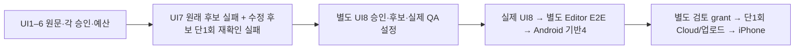

# 승인된 UI8을 UI7 두 후보의 실패 이력과 구분해 결속한다

상태: 사람 승인 범위 기록. [공개용 동일 범위 제안](approved-proposal.md)의 SHA256은 `54b810bbc0ff53d5cfb42069adf9fe57cba49d1a946e7f7331d96b2aea86eb74`, [공개용 최소 승인 영수증](human-approval.json)은 `0a5aa414fe7fb94f454bf2ab787f9cb2b819a0998157ae8fd04dd50a1429d437`다. 비공개 원래 설계 `d6844c2a2afa8dd10a12cf27de6163d0cd9f1c6f41539bf24bb7d3cdfae2c715`와 원래 승인 `4c790c0903bfb463c274be629262bb524c7222a2a9e9b3c756d62f54f1c82f9b`는 별도 hash로 보존하며 원문 자체를 공개했다고 주장하지 않는다. 실제 승인 시각 `2026-10-15T14:17:27.058718+00:00`과 원문 millisecond/epoch 표기를 모두 보존한다. 티켓은 [Spiritgate #240](https://github.com/seorilabs/spiritgate-defenders/issues/240)이다.

## 범위와 실패 경계

기존4/5/6/7 경로는 유지하고 첫 내부 v1의8만 추가한다. 정상 v2의 복수 추가 승인과 개발/실기기 단계 계약은 바꾸지 않는다. UI8은 승인·제안·후보·실제 설정과 UI7 승인 및 원본 자산12종 digest를 결속한다. 입력 진단1회 최대15분은 본180분 안에 포함하며 문제 재확인1회30분까지 총210분이다. UI9·추가 재시작·연장은 없다.

`historicalUi7`은 원래 source/configuration과 수정 재확인 source/configuration을 별도로 둔다. source-before, 원래 configuration/start/source integrity, 수정 전후 파일 목록, 재확인 configuration/start/보수적 clock/final integrity, 최종 실패 result/정확 PID 종료 receipt/원본 manifest의12개 `{id,sha256}` 자산이 모두 원본 관찰 집합에 있어야 한다. source-before 파일과 transition의 old bytes/hash·새 파일 수·중복 경로·선언 project.godot 차이를 대조하고 재확인 helper 실제 hash를 확인한다.

UI7의 원문 승인 config=null은 변경하지 않는다. 원래 후보 본 검수의 실패/미완료와 수정 후보 단일 재확인의 부분 통과·작은 메뉴 실패·전체28/168 미완료와 두 시계를 보존한다. iteration7은 원래 source에 연결하며 completedAt은 최종 실패 관찰 기록을 뜻한다. 원래 실패·차단 상태와 후속 resolutionEvidence를 남기고 새 UI8 전체 PASS로 소급 합산하지 않는다. 실제 종료 완료를 오래된 cleanup pending 기록으로 되돌리지 않는다.

manifest는 직접 다운로드하는 원본 JSON 자산이며 나머지11개 역할 파일의 원본 경로·bytes·hash와 알려진 실패 네 경로를 검증한다. manifest 내부 모든 파일이나 별도 archive를 자동 복원하는 검사는 아니다. 전체 원본의 로컬 보존·독립 복원과 실제 provider 자산 재다운로드 영수증은 실행 원장에서 별도로 유지한다. 실행 로그나 원본 관찰 내용은 이 코드 리뷰로 보내지 않는다.

원래 UI4–7 승인 시각·한도·실패와 각210분, 최종 기능/UX 통과, 별도 실제 Editor 전체 E2E와 Android 기반4, 최초 만료 `2026-10-20T23:16:52.580641Z`, v1 종료 `2026-10-22T00:00:00Z`, 한 후보·한 Cloud 빌드·한 업로드, 실제 프로덕션 서명 검증, 정상 v2·L3·iPhone 검수와 공개 검증을 유지한다. registry는 빈 배열이다. 실제 UI8·E2E·Android 근거가 없으면 grant·번호·태그·빌드를 만들지 않는다.

현재 실제 UI8은 진단 단계에서 차단되어 제품 Run·후속 전체 E2E·Android 근거가 없다. 실행 전 source/QA 설정 동결은 완료 근거일 뿐 제품 통과가 아니다. `configurationFingerprint`는 첫 내부 v1의 Godot Editor 개발 QA 참조이며 native market 설정/실행 근거가 아니다. Android는 별도 지문, iOS 실제 설정·workingOverrides·서명 산출물·실기기 검수는 별도 요구한다. 정상 v2의 마켓 실기기 지문과 혼용하지 않는다.

## 인수조건과 검증

- AC-8-1: 별도 UI8 승인·제안·후보·실제 설정·UI7 원본12종 digest와 정확한8회만 허용한다.
- AC-8-2: UI7의 두 후보·설정·source 전환·실패/미완료·단일 재확인·보수적 clock·실제 종료·원본 manifest 누락/변조를 거절한다.
- AC-8-3: 과거 승인/실패/예산·현재 마지막 기능/UX·별도 E2E·Android·168시간·만료·v1 종료·공개 금지를 유지한다.
- AC-8-4: 최신 중앙 검증/승인/제안/철회를 확인하고 실제 미등록/미실행 상태를 보존한다.

[중앙 L1/dev 테스트 계획](test-plan.json)은 validator의 순수 합성 fixture만 대상으로 한다. service/public은 중앙 PR 반영을 뜻하고, 제품의 승인된 전체28·L3·실기기 범위를 줄이지 않는다. 8회 허용 RED → 최소 구현 GREEN → malformed/hash/order/expiry/missing history/소급 PASS 공격 회귀 → 전체 중앙 검사·pack·actionlint·diff를 수행한다. 제품 실행 PASS로 보고하지 않는다.

## 검토·운영·되돌리기

격리 feature 브랜치의 한국어 Ready PR과 필수 검사 후 최종 코드 diff만 도구 없는 Claude 읽기 전용 리뷰로 전송한다. 자동 Copilot 포함 요청2회가 상한이며 세 번째는 없다. 실제 UI8 Run 전 source/QA설정 freeze를 받은 뒤 최종 승인 결속을 확정하고 리뷰한다. 실제 grant 등록은 이후 별도 검토 PR이다. 되돌리기는 PR로 수행하며 이전 원문을 지우지 않는다.
