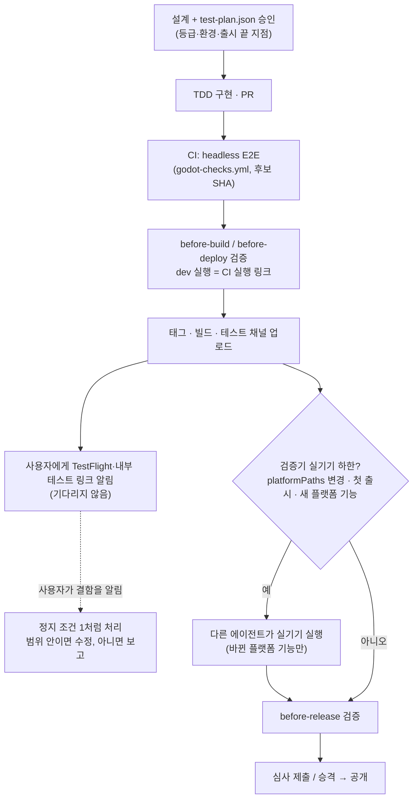

# 설계: Godot 게임의 headless E2E 기본 검수와 실기기 범위 축소

- 설계 ID·버전: `2026-10-16-godot-headless-e2e`, v1
- 상태: 승인 (2026-10-16, 아래 [승인·추적](#승인추적))
- 중앙 기준: `73e746a` (origin/main)
- 대화 결정(2026-10-16): 에이전트 실기기 범위는 "최초 결제·인증 + 플랫폼 변경", headless E2E는 "CI 실행을 독립 실행으로 인정", 적용 대상은 "Godot 게임만"
- 보강 대상: [변경 등급별 테스트 계획 v1](../2026-10-14-test-levels/design.md)의 기반 기능 실기기 하한과 L3 실행자 규칙(등급표·앞단 승인·정지 조건은 유지)

## 목적·범위·근거

### 문제

| 지금 규칙 | 결과 |
|---|---|
| 기반 기능(결제·광고·로그인·저장)의 `paths`에 화면·게임 로직까지 들어가 있어, 상점 화면 문구만 바꿔도 실기기 실행이 하한이 된다 | 실기기 실행이 거의 매 릴리스의 병목이 된다 |
| 실기기 실행과 L3 실행은 구현자와 **다른 에이전트**가 해야 한다 | 스크립트로 돌리는 검사도 다른 에이전트를 띄워 다시 돌린다 |
| "headless 단위 테스트만으로 실제 실행을 대신하지 않는다"만 있고 headless **E2E**의 기준이 없다 | 게임마다 이미 있는 headless 검사(예: lizard-tycoon `tools/e2e_journey.gd`)를 정식 실행으로 쓰지 못한다 |
| 사용자의 TestFlight·내부 테스트 확인과 에이전트의 실기기 실행이 구분되지 않는다 | 사람 확인을 기다리느라 진행이 멈춘다 |

### 결과

```text
지금   구현 ─ 개발 환경 실행 ─ 빌드 ─ 테스트 채널 ─ [다른 에이전트 실기기: 기반 기능 경로마다] ─ 제출 ─ 공개

변경 후 구현 ─ headless E2E(CI) ─ 빌드 ─ 테스트 채널 ─ ┬ 실기기는 플랫폼 변경·최초 결제·인증일 때만 ─ 제출 ─ 공개
                                              └ 사용자는 원할 때 TestFlight·내부 테스트로 확인(진행을 막지 않음)
```

| 상황 | 에이전트 실행 | 실기기 |
|---|---|---|
| 상점 화면·광고 노출 시점·보상 수치·저장 형식·UI 변경 | headless E2E (대체 광고·결제·저장 구현) | 없음 |
| 광고·결제·로그인 SDK, 네이티브 플러그인, export·권한 설정 변경 | headless E2E + 실기기 | 바뀐 플랫폼 기능을 Android 기본, iOS 전용 코드면 iPhone |
| 새 게임 첫 출시, 새 마켓 진출 | 전체 headless E2E(CI) + 실기기 | 플랫폼 기능 전체(결제·로그인 포함). 낮출 수 없음 |
| 기존 게임에 결제·로그인을 처음 추가 | headless E2E + 실기기 | 새 기능. 낮출 수 없음 |
| 엔진 업그레이드 | 전체 headless E2E(CI) + 실기기 | 설계에서 L3 + `android`(필요 시 `ios`)로 계획 |

### 포함·제외

| 포함 | 제외 |
|---|---|
| Godot headless E2E의 최소 기준과 실행 종류 `godot-headless-e2e` | RN 비게임 앱(현행 v1 규칙 유지, 나중에 따로 결정) |
| 기능 목록 v2: 실기기 하한을 `platformPaths`(플랫폼 경로)로 한정 | 등급표(L1~L3)·앞단 승인·정지 조건·출시 끝 지점 |
| 첫 출시·새 플랫폼 기능의 실기기 하한은 낮출 수 없음 | 새 화면·UI 개편의 독립 검수 3회(렌더링 실행 필요, 현행 유지) |
| CI 실행을 독립 실행으로 인정하고 검증기가 GitHub API로 확인 | 실기기 실행의 독립 실행자 규칙(현행 유지) |
| 사용자의 테스트 채널 확인은 선택이며 게이트가 아님 | 마켓 문구 검수·심사 자체 |
| `godot-checks.yml`에 E2E 결과 보관 입력 추가 | 게임별 E2E 틀 일괄 구축(각 게임의 다음 작업에서 진행) |
| `~/.agent` 지침·스킬 정렬과 E2E 작성 방법 문서 | 이미 진행 중인 릴리스(기능 목록 v1은 그대로 검증) |

## Godot headless E2E 기준

개발 환경 실행 `godot-headless-e2e`로 인정하는 최소 기준이다. probe·단위 테스트·스크린샷만으로는 인정하지 않는다.

| # | 기준 | 예 |
|---|---|---|
| E1 | 실제 시작 장면과 실제 UI 트리를 띄운다 | `res://main.tscn`을 그대로 인스턴스화. 화면을 우회하는 테스트 전용 장면 금지 |
| E2 | 대체 구현은 플랫폼 경계에만 둔다 | 광고·결제·로그인·클라우드 저장·원격 설정·분석·시계·난수. 게임 로직·화면은 실제 코드 |
| E3 | 입력은 화면 좌표의 실제 입력 이벤트로 넣는다 | 버튼 중심에 `InputEventScreenTouch`·`InputEventMouseButton`, 목록은 드래그 이벤트. `pressed.emit()`·함수 직접 호출로 화면을 건너뛰지 않는다 |
| E4 | 한 여정을 끝까지 잇는다 | 시작 → 기능 사용 → 저장·화면 전환 → 오류·취소·복구 → 종료·재실행 후 저장 복원 |
| E5 | 격리·결정성 | 임시 저장 경로, 고정 시드·시계, 기기 논리 해상도(예: 390x844) `SubViewport`, 실행마다 같은 결과 |
| E6 | 기능 목록 전체를 덮는다 | 시나리오의 기능 ID 합이 `docs/qa/feature-inventory.json`의 모든 기능을 포함 |
| E7 | 실패를 숨기지 않는다 | `journey.json`(시나리오·기능 ID·통과 여부), 실패 시 exit 1, 로그의 `SCRIPT ERROR`·`ERROR:` 검사, 명령 시간 제한 |
| E8 | 화면 확인은 같은 여정의 렌더링 모드 | `--headless` 없이(macOS 창 또는 Linux `xvfb-run`) 돌려 장면별 PNG를 남긴다. headless는 그림을 그리지 않으므로 화면 변경의 시각 검수를 대신하지 않는다 |

실행 예:

```bash
godot --headless --path . --script tools/e2e/journey.gd -- --out build/e2e   # 게이트
godot --path . --script tools/e2e/journey.gd -- --out build/e2e --capture   # 화면 변경 때 PNG
```

작성 방법·대체 구현 주입·입력 도우미·`journey.json` 형식은 `~/.agent`의 `godot-game` 스킬 `references/headless-e2e.md`에 둔다.

## 사용자 흐름



## 구조·책임·의존성

| 위치 | 바뀌는 것 |
|---|---|
| `contracts/development-workflow.yaml` | `environmentKinds.dev`에 `godot-headless-e2e`, `floors.platformPaths`·`defaultPlatformPaths`·첫 플랫폼 확인 규칙, `runs.ciExecutor` |
| `contracts/development-evidence.schema.json` | 실행 종류 추가, `executor: "ci"`이면 `ciRun.url` 필수, CI 실행은 개발 환경 종류만 |
| `contracts/test-plan.schema.json` | `floorOverrides`에 `{rule: "platform", featureId, reason}` |
| `scripts/release/test-plan.mjs` | 기능 목록 v2 검증, v2 하한 계산 |
| `scripts/release/verify-development-evidence.mjs` | CI 실행 확인, 기준 태그 시점 기능 목록 읽기(새 기능 판정) |
| `.github/workflows/godot-checks.yml` | 선택 입력 `e2e_report_path`: E2E 결과(`journey.json`·로그) artifact 보관 |
| `docs/agent-governance/development-workflow.md`, `templates/` | 위 규칙, v2 기능 목록·실행 기록 예시 |
| `~/.agent` | AGENTS.md, 개발 정책, `development-workflow`·`godot-game`(+`references/headless-e2e.md`)·`seorilabs-release-run`·`multimarket-launch-completion`·`game-outgame-framework` |

### 기능 목록 v2

`schemaVersion: 2`로 올린 게임만 새 하한을 쓴다. v1은 지금 규칙 그대로다. **headless E2E 틀과 CI가 준비된 게임만 v2로 올린다.**

```json
{
  "schemaVersion": 2,
  "e2e": { "workflow": ".github/workflows/godot-checks.yml", "command": "npm run test:e2e" },
  "regressionPaths": ["project.godot", "addons/**"],
  "platformPaths": ["export_presets.cfg", "android/**", "ios/**", "**/*.gdextension", "**/*.gdap"],
  "features": [
    { "id": "core-loop", "core": true, "paths": ["scenes/game/**", "scripts/game/**"] },
    { "id": "shop", "core": false, "foundation": true,
      "paths": ["scenes/shop/**", "scripts/shop/**", "scripts/platform/iap/**"],
      "platformPaths": ["scripts/platform/iap/native_*.gd", "android/plugins/billing/**"] }
  ]
}
```

| 필드 | 뜻 |
|---|---|
| `e2e.workflow` | 후보 SHA의 headless E2E를 돌리는 workflow 파일. CI 실행 확인에 쓴다. 필수 |
| `features[].platformPaths` | 바뀌면 그 기능을 실기기에서 실행해야 하는 경로(네이티브 플러그인, SDK 호출 구현). 대체 구현 뒤의 게임 로직·화면은 넣지 않는다 |
| 최상위 `platformPaths` | 바뀌면 플랫폼 기능 전체(없으면 핵심 기능)를 실기기에서 실행. 생략하면 중앙 기본값 |
| `foundation`·`paths` | 이어받기와 기능 실행 범위 계산에 그대로 쓴다. v2에서는 실기기 하한을 만들지 않는다 |

### v2 하한

| 바뀐 파일·상황 | 하한 | 낮추기 |
|---|---|---|
| 기능 `paths` (기반 기능 포함) | 그 기능을 계획한 환경에서 실행 | 해당 없음 |
| 기능 `platformPaths` | 그 기능을 검증 중인 마켓 플랫폼의 실기기에서 실행(L2) | `{rule: "platform", featureId}` |
| 최상위 `platformPaths` | 플랫폼 기능 전체(없으면 핵심 기능)를 실기기에서 실행 | 기능마다 `{rule: "platform", featureId}` |
| `regressionPaths`·비교 불가 | 계획한 환경마다 전체 회귀(L3) | `{rule: "regression"}` |
| `baseline: null` (첫 출시·새 마켓) | 전체 회귀(L3) + `platformPaths`가 있는 기능 전체 실기기 | **낮출 수 없음** |
| 기준 태그의 기능 목록에 없던 기능의 `platformPaths` (결제·로그인 처음 추가 등) | 그 기능 실기기 | **낮출 수 없음** |

v1의 `{rule: "foundation"}`은 v2 기능 목록에서 계획 오류이고, `{rule: "platform"}`은 v1에서 계획 오류다.

### CI 실행을 독립 실행으로 인정

```json
{
  "id": "e2e-ci",
  "kind": "godot-headless-e2e",
  "executor": "ci",
  "ciRun": { "url": "https://github.com/seorilabs/example/actions/runs/123456789" },
  "sourceSha": "<후보 SHA>",
  "scenarios": [{ "id": "first-session", "status": "passed", "featureIds": ["core-loop", "shop"], "evidence": ["journey.json artifact"] }]
}
```

검증기는 `executor: "ci"` 실행마다 GitHub API로 확인한다.

| 확인 | 실패 코드 |
|---|---|
| 같은 저장소의 실행, `head_sha` = 후보 SHA | `CI_RUN_MISMATCH <run>` |
| `status: completed`, `conclusion: success` | `CI_RUN_NOT_SUCCESSFUL <run>` |
| workflow 경로 = 기능 목록 `e2e.workflow` | `CI_RUN_WORKFLOW <run>` |
| 조회 실패·토큰 없음 | `CI_RUN_UNVERIFIED <run>` |
| 개발 환경 종류가 아님 | `CI_RUN_KIND <run>` |

확인된 CI 실행은 구현자와 다른 실행자로 본다. 따라서 L3의 개발 환경 실행은 CI 실행이나 다른 에이전트 실행이어야 하고, 구현자가 직접 돌린 실행은 지금처럼 `INDEPENDENT_RUN_REQUIRED`다. 실기기 실행의 독립 실행자 규칙은 바꾸지 않는다. 168시간 기한은 API의 `updated_at`으로 계산한다.

### 사용자의 테스트 채널 확인

- 테스트 채널 업로드 뒤 TestFlight·Play 내부 테스트·앱인토스 링크를 알리고 **기다리지 않고** 계획의 끝 지점까지 진행한다.
- 사용자가 결함을 알리면 테스트 실패로 다룬다. 승인 범위 안이면 고쳐 새 후보로 진행하고, 범위 밖이면 정지 조건 1로 보고한다.
- 사용자가 먼저 보고 싶은 릴리스는 설계의 `release.until`을 `test-track`으로 정한다.
- 사용자의 확인은 실행 근거(`runs`)에 넣지 않는다. 에이전트 실행만 기록한다.

### 게임별 E2E 틀 마련

- Godot 게임 작업을 시작할 때 기능 목록이 v1이거나 E2E 틀이 기준(E1~E8)에 못 미치면, 그 게임의 다음 작업에서 **먼저** 틀을 만든다. 순서는 E2E 여정 → CI `test:e2e` → 기능 목록 v2(`platformPaths`·`e2e`) 전환이다.
- 제품 동작을 바꾸지 않는 테스트 코드·CI·기능 목록 변경은 이 설계의 승인으로 진행한다. 대체 구현을 주입하려고 제품 구조(어댑터 경계 등)를 바꿔야 하면 그 게임의 설계에 포함해 승인받는다.
- 틀을 마련하기 전 릴리스는 v1 규칙으로 검증한다. 틀이 없다는 이유로 실기기 하한을 낮추지 않는다.
- 기준 구현은 `starter-template-game`에 먼저 넣고(후속 티켓), 이미 여정형 E2E가 있는 lizard-tycoon·alley-market-match는 기준과의 차이만 메운다.

## 데이터·인터페이스·실패 처리

- 기준 태그 시점 기능 목록: 원격은 contents API(`ref=<baseline>`), 로컬은 `git show <baseline>:docs/qa/feature-inventory.json`. 없거나(404) 읽을 수 없으면 모든 기능을 새 기능으로 본다(실기기 하한이 올라가는 쪽).
- CI 실행 조회는 로컬 `--file` 검증에서도 한다. `GH_TOKEN`·`GITHUB_TOKEN`이 없으면 `CI_RUN_UNVERIFIED`로 실패한다(통과로 넘기지 않음).
- `ciRun.url`은 `https://github.com/<owner>/<repo>/actions/runs/<id>`(선택 `/attempts/<n>`)만 받는다. 다른 저장소의 실행은 `CI_RUN_MISMATCH`.
- 기능 목록 v1·근거 v2 조합은 지금과 같은 결과를 낸다(회귀 테스트로 고정).

## 품질 요구사항

- 검증기 추가 API 호출: CI 실행마다 1회, 기준 태그 기능 목록 1회. 기존 rate limit 안.
- 보안: 토큰 값을 출력하지 않는다. `ciRun.url`의 저장소·실행 ID만 파싱해 고정 API 경로로 조회한다.

## 대안·주요 결정

| 결정 | 선택 | 버린 대안과 이유 |
|---|---|---|
| 실기기 범위 | 최초 결제·인증 + 플랫폼 변경(대화 결정) | 최초 결제·인증만: 네이티브 변경 결함이 심사·사용자 단계에서 처음 드러남 |
| 플랫폼 변경 판정 | 기능 목록의 `platformPaths`로 검증기가 계산 | 사람 판단만: 변경 파일과 실제 실행이 어긋나도 못 잡음 |
| 전환 방식 | 기능 목록 v2 opt-in, E2E 틀이 준비된 게임만 | 전 게임 일괄 전환: 틀 없는 게임에서 실기기 없이 개발 환경 실행만 남아 검수 공백 |
| 독립 실행 | CI 실행을 API로 확인해 인정(대화 결정) | 작성자 실행만: L3 독립성 상실 / 현행: 같은 스크립트를 다른 에이전트가 다시 돌리는 비용 |
| CI 결과 대조 깊이 | 실행 성공·SHA·workflow 경로 | artifact의 `journey.json`까지 검증기가 내려받아 시나리오 대조: zip 처리 추가. 운영해 보고 필요하면 후속 |
| 적용 대상 | Godot 게임만(대화 결정) | RN 앱 동시 적용: RN Web과 네이티브 렌더러 차이가 커서 별도 판단 필요 |
| 사용자 테스트 채널 확인 | 게이트 아님, 결함 보고 시 실패로 처리 | 매번 대기: 사람 확인 지점이 다시 흩어짐 |

## 인수조건·테스트·검수

| ID | 통과 기준 | 테스트 |
|---|---|---|
| AC-1 | v2 기능 목록에서 기반 기능의 `paths`만 바뀌면 실기기 하한이 없고 dev 실행으로 통과 | 검증기 단위 |
| AC-2 | 기능 `platformPaths`가 바뀌면 `before-release`에서 실기기 실행 없으면 `TEST_LEVEL_BELOW_FLOOR platform` | 단위 |
| AC-3 | AC-2에서 승인 커밋의 `{rule:"platform"}`이 있으면 통과 | 단위 |
| AC-4 | 최상위 `platformPaths`(또는 중앙 기본값)가 바뀌면 플랫폼 기능 전체, 없으면 핵심 기능이 실기기 하한 | 단위 |
| AC-5 | `baseline: null` 또는 기준 태그 기능 목록에 없던 기능은 `{rule:"platform"}`이 있어도 실기기 하한 유지 | 단위 |
| AC-6 | `executor:"ci"` 실행이 API로 확인되면 L3 독립 실행으로 통과, SHA·결론·workflow·저장소가 다르면 각 실패 코드 | 단위(가짜 fetch) |
| AC-7 | `executor:"ci"`인데 `ciRun`이 없거나 실기기 종류면 스키마·`CI_RUN_KIND` 실패 | 단위 |
| AC-8 | 토큰 없음·조회 실패는 `CI_RUN_UNVERIFIED` | 단위 |
| AC-9 | v1 기능 목록의 기존 결과가 그대로이고 `{rule:"platform"}`은 v1에서, `{rule:"foundation"}`은 v2에서 계획 오류 | 기존 회귀 + 단위 |
| AC-10 | `godot-checks.yml`의 `e2e_report_path`가 있으면 artifact를 올리고 없으면 기존과 같음 | actionlint, workflow 계약 테스트 |
| AC-11 | `~/.agent` 지침·스킬이 이 설계와 일치하고 "기반 기능 = 실기기" 문구가 Godot v2에 남지 않음 | 문서 검색, 스킬 검증, `validate_outgame.py` 테스트 |

TDD: AC-1~AC-9는 실패 테스트를 먼저 작성한다. AC-10·11은 workflow·문서 변경이라 actionlint·계약 테스트·검색으로 확인한다. 정책·검증기 변경이므로 제품 실행 기록과 `test-plan.json`을 만들지 않는다. 검증은 중앙 `npm test`, actionlint, `~/.agent` 스킬 검증이다.

## 적용·운영·되돌리기

| 순서 | 저장소 | 내용 |
|---|---|---|
| 1 | `seorilabs/.github` | 이 설계 커밋 → 계약·스키마·검증기·`godot-checks.yml`·문서·템플릿 (PR A, 릴리스 실행 로직이라 Codex 교차 리뷰) |
| 2 | `magicsih/agent-config` (`~/.agent`) | AGENTS.md, 개발 정책, `development-workflow`, `godot-game` + `references/headless-e2e.md`, `seorilabs-release-run` 5단계(사용자 확인 비게이트), `multimarket-launch-completion` 마켓 QA 행, `game-outgame-framework`(출시 단계 `device` 보고서 → 선택, `market_sdk`는 유지) |
| 3 | `seorilabs/starter-template-game` | 기준 E2E 틀·CI·기능 목록 v2 (후속 티켓) |
| 4 | 각 Godot 게임 | 다음 작업에서 틀 마련 → v2 전환 |

- 진행 중 릴리스: 기능 목록 v1은 결과가 바뀌지 않으므로 영향 없다.
- 되돌리기: PR A revert 시 v2 기능 목록은 `SOURCE_FEATURE_INVENTORY_REQUIRED`로 막힌다. 그 경우 해당 게임 기능 목록을 v1으로 되돌린다.
- 남은 위험: 대체 구현 뒤의 경계가 잘못 그어지면(네이티브 호출이 `platformPaths` 밖에 있으면) 실기기 하한이 생기지 않는다. v2 전환 PR에서 플랫폼 호출 파일 목록을 `platformPaths`와 대조하고, 사용자 테스트 채널 확인에서 나온 결함은 그 경로를 `platformPaths`에 추가하는 것으로 고친다.

## 승인·추적

승인 요청 범위(한 번에):

1. 이 설계 v1과 위 순서 1·2의 구현, 순서 3·4의 후속 티켓 발행.
2. 순서 1·2의 PR을 CI·교차 리뷰·미해결 thread 0 확인 뒤 병합(병합은 PR 번호별로 확인받음).

승인 뒤 승인 문구와 커밋을 이 절에 기록하고 [설계 목록](../README.md)에 추가한다.

### 승인 기록

- 2026-10-16 대화에서 사용자 승인: 선택지 "승인". 대상은 검토용 커밋 `f6f07f0`의 이 문서(SHA-256 `250c9c778200dc809cd5459c3fbf3ae1483a0555667f6eea457d92366286a8b2`)와 위 승인 요청 범위 1·2다. 커밋 메시지만 고친 `408faef`의 문서도 같은 bytes다.
- 구현 중 조정(설계 범위 안): `godot-checks.yml`의 E2E 결과 artifact는 조직 정책(`contracts/release-policy.yaml`의 `artifacts.retentionDays: 3`)을 따른다. 실행 근거의 확인은 artifact가 아니라 CI 실행 API로 하므로 168시간 기한 검증과 무관하다.
