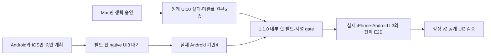

# Mac Editor 생략의 좁은 승인 결속과 native 검수 순서

현재 제품 QA 통과·grant·Cloud 빌드는0이다. 사용자 직접 결정은 [human-approval.json](human-approval.json), 동일 범위는 [approved-proposal.md](approved-proposal.md), 기존 실패와 새 후보의 구분은 [approval.json](approval.json)에 보존한다. 원문 질문·개인 경로·식별자·실행 관찰은 공개하지 않는다.

AC-MAC-1: 정상 v2 native-only 조기 단계는 아직 없는 실기기/UI3 실행을 요구하지 않는다. dev 포함 조기 단계와 공개 단계의 UI3·독립성·같은 후보·168시간·모든 계획/L3 하한은 유지한다. 기록된 실패를 무시하지 않는다.

AC-MAC-2: 첫 내부 bootstrap의 Mac skip은 별도 검토된 사람 승인·현재 후보·이전 UI10 승인·원문6역할 해시를 모두 확인한다. UI10의 실제 첫 실패·입력0/별도 raw키2·Run1·미완료·PASS0·원래180/210분·소유 PID 정상 종료·source/helper와 두 manifest를 대조한다. 기존 승인/실패를 재작성하거나 새 Editor 실행을 허용하지 않는다.

AC-MAC-3: Android 기반4는 실제 같은 새 후보의 실기기 통과가 필요하며 그 완료시각만 결과에 쓴다. before-deploy는 동일 grant/skip 승인·같은 build/provider·정확 signed artifact를 계속 요구한다. 원래 만료/168시간·v1 종료·1후보/1빌드/1업로드·nativeQaWaived=false·productE2eStatus=blocked·publicReleaseAllowed=false를 유지한다. 공개 native L3/UI3·전체 E2E는 면제하지 않는다.

TDD는 실제 공개 validator에 넣은 합성 입력으로 조기 native-only 및 Mac skip 미지원 RED를 기록한 뒤 최소 구현 GREEN과 공격 입력을 검사한다. 전체 npm test·pack·actionlint·diff와 기존 bootstrap4~10/정상 v2 회귀를 수행한다. 합성 fixture는 제품·기기 QA 근거가 아니다. 수동 관찰·실기기·마켓 검수는 이 중앙 코드 변경으로 수행하지 않는다.

기존 normal v2만 첫 내부에 쓰는 대안은 앱의 예외 전용 exact signed-artifact 자동 업로드 gate를 그대로 보존하지 못한다. 앱 소스/서명 경로 변경 대신 기존 bootstrap에 명시적 Mac skip 한 경로만 추가한다. 이전 v1 입력은 변경하지 않으며 opt-in Mac skip이 없는 후보에는 기존 Editor 검사가 적용된다. 삭제 조건은 원래 v1 종료이며 영구 waiver나 새로운 pipeline은 만들지 않는다.

중앙 L1/dev 계획은 검증기 변경 검사에 한정한다. 제품 전체28·168·L3·실기기·E2E의 하한을 낮추지 않는다. Ready 한국어 PR과 필수 검사까지 허가됐으며 최종 CODE6파일 외부 전송·병합은 현재 보류다. 실제 자동 요청도 리뷰2회 상한에 포함한다. registry[]는 비워 둔다.
