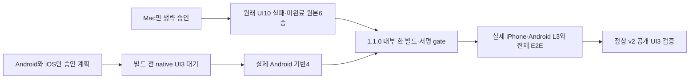

# Mac Editor 생략의 좁은 승인 결속과 native 검수 순서

현재 제품 QA 통과·grant·Cloud 빌드는0이다. 사용자 직접 결정은 [human-approval.json](human-approval.json), 동일 범위는 [approved-proposal.md](approved-proposal.md), 기존 실패와 새 후보의 구분은 [approval.json](approval.json)에 보존한다. 원문 질문·개인 경로·식별자·실행 관찰은 공개하지 않는다.

AC-MAC-1: 정상 v2에서 Spiritgate의 정확한 통합 승인 계획 하나에 한해 native-only 조기 단계의 UI3 횟수를 미룬다. repo·google-play/app-store·승인된 design ID·cfe 승인 커밋·같은 폴더의 정확한 설계/계획 경로가 모두 맞고 앞선 승인/후보 조상 검증을 통과해야 한다. 다른 repo/새 계획/다른 마켓·단계의 기존 조건은 유지한다. dev 포함 조기 단계와 공개 단계의 UI3·독립성·같은 후보·168시간·모든 계획/L3 하한은 유지한다. 기록된 실패를 무시하지 않는다.

AC-MAC-2: 첫 내부 bootstrap의 Mac skip은 별도 검토된 사람 승인·현재 후보·이전 UI10 승인·원문6역할 해시를 모두 확인한다. UI10의 실제 첫 실패·입력0/별도 raw키2·Run1·미완료·PASS0·원래180/210분·소유 PID 정상 종료·source/helper와 두 manifest를 대조한다. 기존 승인/실패를 재작성하거나 새 Editor 실행을 허용하지 않는다.

AC-MAC-3: Android 기반4는 실제 같은 새 후보의 실기기 통과가 필요하며 그 완료시각만 결과에 쓴다. before-deploy는 동일 grant/skip 승인·같은 build/provider·정확 signed artifact를 계속 요구한다. 원래 만료/168시간·v1 종료·1후보/1빌드/1업로드·nativeQaWaived=false·productE2eStatus=blocked·publicReleaseAllowed=false를 유지한다. 공개 native L3/UI3·전체 E2E는 면제하지 않는다.

TDD는 실제 공개 validator에 넣은 합성 입력으로 조기 native-only 및 Mac skip 미지원 RED를 기록한 뒤 최소 구현 GREEN과 공격 입력을 검사한다. 전체 npm test·pack·actionlint·diff와 기존 bootstrap4~10/정상 v2 회귀를 수행한다. 합성 fixture는 제품·기기 QA 근거가 아니다. 수동 관찰·실기기·마켓 검수는 이 중앙 코드 변경으로 수행하지 않는다.

기존 normal v2만 첫 내부에 쓰는 대안은 앱의 예외 전용 exact signed-artifact 자동 업로드 gate를 그대로 보존하지 못한다. 앱 소스/서명 경로 변경 대신 기존 bootstrap에 명시적 Mac skip 한 경로만 추가한다. 이전 v1 입력은 변경하지 않으며 opt-in Mac skip이 없는 후보에는 기존 Editor 검사가 적용된다. 삭제 조건은 원래 v1 종료이며 영구 waiver나 새로운 pipeline은 만들지 않는다.

중앙 L1/dev 계획은 검증기 변경 검사에 한정한다. 제품 전체28·168·L3·실기기·E2E의 하한을 낮추지 않는다. Ready 한국어 PR과 필수 검사 뒤 최종 CODE6 교차 리뷰는 별도로 확인된 승인 범위에서만 수행하며 병합은 출시 담당자가 최종 확인한다. 실제 자동 요청도 리뷰2회 상한에 포함한다. registry[]는 비워 둔다.

## 정적 근거와 생략 이력의 구분

현재 후보의 정적 evidence envelope는 현재 grant의 source/repository/target을 사용한다. 기존 v1 schema의 설계·구현자·인수조건·TDD·전체 기능·회차 자료 구조를 재사용하며, Editor UI/E2E 완료 부분만 명시적인 skipped 구조로 검증한다. 정적 구현 인수조건은 실제 파일·코드·자동 검사 근거가 있을 때만 passed로 기록한다. 실제 미실행 gameplay/native 검수나 원래28기능의 실행을 그 passed 항목으로 대체하거나 축소하지 않는다. 원래 UI10 마지막 회차와6개 관찰 원본의 source/QA 설정은 과거 후보에 그대로 결속하고, 현재 후보의 실행 통과로 소급하지 않는다. 새 후보의 Android 기반4·후속 native L3·독립 UI3·전체 E2E는 각각 실제 실행 근거가 필요하다.

## 적용·운영·되돌리기

중앙 변경 담당자는 기존 승인 원문을 보존하고 코드 리뷰 지적 처리·최종 전체 회귀·Ready PR/CI를 완료한다. 출시 담당자는 최종 HEAD와 검토 결과를 확인한 뒤 중앙 반영을 판단하며, 새 중앙 정본에서 실제 최종 후보의 단계별 CLI 검증을 수행한다. Android 테스트 빌드→실제 기반4→비공개 원본 자산 대조와 별도 reviewed grant→내부 한 Cloud/정확 서명 gate→iPhone 설치와 공개 전 native 검수 순서를 조율한다. 실제 실행 평가는 구현자와 다른 검수자가 맡는다. 원본 누락/후보 불일치/기한 만료/잘못된 실제 서명 산출물은 출시 담당자가 즉시 중단·원장 기록하며 새 시도나 가짜 PASS로 복구하지 않는다. 현재 grantRegistry가 비어 있으므로 미등록 지원을 되돌릴 때는 중앙 PR로 이 opt-in 지원만 제거하고 기존 실패 원문은 보존한다. 향후 실제 등록 후 오류라면 사용을 중단하고 현행 취소·검토 절차를 따르며 임의로 다른 후보를 등록하지 않는다. 삭제 조건은 원래 v1 종료이고 기한·권한을 연장하지 않는다.

리뷰는 원래 HEAD의 CODE6에 대해 자동 Copilot1회와 별도 명시 승인된 도구 없는 Claude1회로 닫는다. 두 리뷰가 같은 원래 구조 누락을 지적한 것이며, 보정 후 같은 결함이 재발한 두 번째 검토가 아니다. 최종 보정 HEAD는 추가 외부 리뷰 없이 자체 회귀와 필수 CI로 검증하고 원래 검토 HEAD와 구분해 기록한다.

최종 범위 한정: native-only 유예는 모든 저장소의 정책 변경이 아니다. `seorilabs/spiritgate-defenders`의 `2026-10-16-native-release-handoff` 단일 계획, 승인 커밋 `cfe7ee914c980f39d8bf6ca062f86eb1912606fe`, 같은 폴더의 정확한 `design.md`/`test-plan.json`, Google Play/App Store의 dev 없는 before-build/before-deploy에만 적용한다. 기존 approved ancestor/원문 계획 검증을 재사용하므로 후속 후보도 cfe 승인이 조상으로 남아야 한다. 다른 repo/계획/마켓·단계·dev 포함 경로는 기존 UI3 조건을 유지하며 새 waiver 필드·schema·registry는 만들지 않는다.
