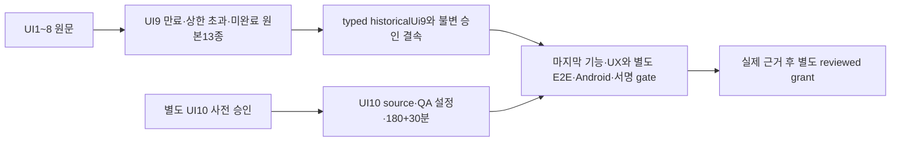

# UI10 승인과 만료된 UI9의 원본 이력 결속

현재 grantRegistry는 비어 있으며 이 변경은 실제 제품 PASS·빌드 허용을 만들지 않는다. 제품 실행 자료는 비공개 원문으로 유지하고 코드 검사는 합성 fixtures만 쓴다.

## 목적·승인·범위

승인된 전체 범위는 [approved-proposal.md](approved-proposal.md), 실제 사용자 승인과 비공개 원문/공개 문서의 구분은 [human-approval.json](human-approval.json), 후보·설정 결속은 [approval.json](approval.json)에 기록한다. 원래 UI9의 두 실행 지시와 사후 구현 승인은 불변이다. 중앙 L1/dev는 검증기 변경 검사이며 제품의 L3·28기능·168영역·실기기 조건을 낮추지 않는다.

## 흐름·책임·데이터

schema는 정확한10과13개 원본 asset 역할 및 capExpired/budgetExceeded/incomplete/0PASS를 요구한다. verifier는 해시·원본 목록 소속·source/helper/Editor 정규화·실제 두 입력 단계·원래 두 마감·늦은 승인·소유 PID 정상 종료·늦은 원본 정리/보고 순서를 검증한다. UI9는 startedAt부터 finalizedAt까지210분을 넘긴 이력으로 받으며, 마지막 실제 입력이 원래 cap 안이고 기한 후 입력/새 실행이 없었다는 사실과 구분한다. 늦은 종료·보고는 새로운 제품 검수가 아니며 기존 상한 위반의 면제가 아니다.

공통210분 검사는 UI4~8과 최종UI10에 그대로 적용한다. UI10 분기의 과거UI9 한 항목만 typed 실패 이력 검증으로 대체한다. legacy v1의 이전 회차 완료시각은 실제 늦은 finalizedAt으로 유지하므로 다음 회차 계획·전체 E2E가 그보다 빨라질 수 없다. 과거 실패에 새 검수 근거를 연결해도 과거 상태는 blocked/incomplete로 보존한다. 정상v2·제품·workflow·서명 guard·registry는 변경하지 않는다.

## 인수조건·검사

- AC-10-1: 별도 UI10 승인/제안/공개 receipt/원문 hash/source/QA 설정을 정확히 결속하고 승인 전 계획·다른 후보·설정·불완전 결속·UI11을 거절한다.
- AC-10-2: 과거 UI9의13개 원본 bytes와 두 manifest를 대조하고 null/배열/불완전 JSON·누락/변조/중복·알려진 실패를 PASS로 바꾼 입력을 거절한다.
- AC-10-3: UI9의 원래 source/config/180+1회30/인계와 늦은 승인·종료·보고를 그대로 보존한다. 210분 안 완료로 소급한 입력·기한 후 실제 입력/새Run·타PID 종료·다른 관찰자·마감 확장·늦은 승인 소급을 거절한다. 마이크로초 비교는 절삭하지 않는다.
- AC-10-4: UI1~9 불변 승인, 이전 실패, 최종 기능/UX·별도90분 E2E·Android 기반4·원래 만료/168시간·한 후보/Cloud/업로드·정확 서명·iPhone·정상v2/L3/공개 조건을 유지한다.

TDD는 미지원10 fixture의 실제 validator RED → 최소 보정 GREEN 및 공격 입력 회귀다. 전체 npm test·pack·actionlint·diff를 수행하며, fixture 통과는 제품 QA의 통과가 아니다. 기존4~9 경로와 provider/서명·정상v2 회귀도 실행한다.

## 대안·운영·제거

정상v2는 개발→TestFlight→실기기 순서를 지원하지만 현재 앱의 첫 내부 예외 전용 exact signed-artifact 업로드 guard와 같은 자동 강제 경로를 그대로 대체하지 않는다. 제품 SHA를 바꾸는 새 서명 흐름보다 기존 first-internal 경로의 정확한10/과거9 실패 결속만 추가한다. 정상v2 변경이나 서명 약화는 하지 않는다.

Ready 한국어 PR에서 CODE3파일만 제한 Claude 읽기 전용 검토하고 자동 Copilot 포함 최대2회에서 닫는다. 지적별 처리·필수 검사·미해결0·최종HEAD·충돌없음을 확인해 squash merge한다. 실제 UI10·E2E·Android 증거가 없으면 grant를 만들지 않는다. rollback은 미등록 지원 제거이며 v1은 원래 종료 시 전체 과도기 경로와 함께 정리한다.
