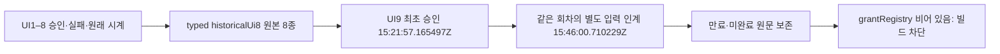

# UI9의 별도 입력 인계와 과거 UI8 실패를 보존한다

사용자가 2026-10-15T23:37:09.228686Z에 [준비한 제안](approved-proposal.md)의 중앙 최소 보정·CODE 3파일 한정 읽기 전용 Claude 리뷰·필수 검사 후 병합을 승인했다. [구현 승인 최소 영수증](implementation-approval.json)의 원문 hash는 비공개 원본 메시지 bytes를 가리킨다. 질문·메시지 ID·개인 경로·실행 로그·관찰 원문은 공개하지 않는다. 티켓은 [Spiritgate #240](https://github.com/seorilabs/spiritgate-defenders/issues/240)이며, v1 제거 후속은 [중앙 #249](https://github.com/seorilabs/.github/issues/249)다.

현재 UI9는 원래 본·절대 마감이 지난 미완료 기록이다. 실제 제품 PASS·별도 전체 E2E·Android 검수 완료나 grant 등록은 없다. 이번 코드 승인은 UI9 재개·추가 회차·시간 연장·빌드 승인이 아니다.

## 데이터와 시각

[회차 승인 결속](approval.json)의 `approvalRecordedAt`은 최초 UI9 허용 시각이다. [두 실행 지시의 최소 영수증](human-approval.json)은 최초 사람 조작과 이후 독립 agent 입력 허용을 서로 다른 시각·원본 hash로 보존한다. 두 과거 지시에 새 CODE·외부 전송 권한을 소급 포함하지 않는다. 그 권한은 별도의 23:37 구현 승인 영수증이다. 최초 실행 설계는 직접 지시의 실행 상세이며 사전 제안으로 제시됐다고 주장하지 않는다. `approved-proposal.md`는 승인받은 초안 bytes를 그대로 보존하므로 당시의 승인 전 상태 문구를 포함한다.

후속 인계는 같은 round9·source·QA fingerprint·시작 시각에 결속하며, 시작→인계→실제 종료의 순서와 기존 180/210분 마감을 검사한다. 마이크로초를 절삭해 서로 다른 승인·시작·마감 표기를 같다고 처리하지 않는다. `inputMode: human-then-agent`는 실제 입력 이력을 표현한다. 이전 사람 입력을 agent 입력으로 바꾸거나 저자의 입력 확인을 독립 기능 PASS로 세지 않는다. 구현자와 다른 agent가 실제 근거를 관찰·재현·평가해야 하며 메타데이터만으로 이를 증명하지 않는다.

`historicalUi8`은 당시 source/QA fingerprint와 source-before, configuration, frozen manifest, execution start, final source integrity, blocked result, 정확 PID cleanup, final manifest의 8개 `{id,sha256}` 자산을 요구한다. 원본 집합 포함·bytes/hash·manifest membership과 source/config/helper·기존 진단 시계·제품 실행0·전체 기능/행렬 미실행·정확 소유 PID 정리를 대조한다. 당시의 `ui9=notapproved/notrun` 문구도 이후 승인으로 고치지 않는다. wrapper가 다운로드하지 않은 나머지 원본 전체를 자동 검증했다고 주장하지 않으며 원본 보관/복원은 별도 실행 원장에 남긴다.

## 불변 조건과 인수조건

- AC-9-1: 정확한 9회, 별도 승인·제안·최종 source/QA fingerprint와 과거 UI8 원본 8종을 결속한다. 10회·미결 설정·임의 원문 교체를 거절한다.
- AC-9-2: UI8의 차단·제품0·기능/행렬 미실행·실패 원문·원래 15/180/210분·정확 PID cleanup·최종 해시 시간을 보존한다. 기존 UI1–7 승인·실패·source/config·예산도 불변이다.
- AC-9-3: 최초 사전 승인과 나중 입력 인계를 구분하며 같은 회차·시계·후보·helper와 독립 평가를 유지한다. 순서·hash·미세 시각·인계 중 clock reset·저자 입력의 독립 PASS 처리를 거절한다.
- AC-9-4: 마지막 기능/UX, 별도 Editor 전체 E2E 1회90분, Android 기반4, 기존 168시간/최초 만료, provider/정확 서명/동일 build와 공개 금지 게이트를 보존한다. registry[]이면 실제 실행은 차단된다.

UI9 원래 시작은 15:35:03.550922Z, 본 마감은18:35:03.550922Z, 절대 마감은19:05:03.550922Z다. 본180분＋단1회30분, 전체28기능·7언어×3크기×8패널168, 별도 E2E와 Android 기반 검수를 줄이지 않는다. 원래 만료2026-10-20T23:16:52.580641Z, v1 종료2026-10-22T00:00:00Z, 한 후보·한 Cloud 빌드·한 업로드, 실제 iPhone·정상 v2/L3·양대 마켓 공개 조건을 유지한다. 이번 만료된 UI9를 다시 실행하지 않는다.

QA fingerprint는 첫 내부 Godot Editor 검수 참조이며 native market 설정/실행 지문이 아니다. Android 별도 지문과 iOS 실제 설정·workingOverrides·서명 산출물·기기 검수는 별도로 요구한다.

## 검증·대안·운영

[중앙 L1/dev 계획](test-plan.json)은 순수 validator fixture를 검사하며 service/public은 중앙 PR 반영을 뜻한다. 제품 L3·28기능·실기기 범위를 축소하지 않는다. 기존 9회 스키마 거절 RED, 사람 전용 조건의 별도 인계 거절 RED, 최소 구현 GREEN과 malformed/hash/source/config/order/expiry/소급 PASS/이력 누락·전체 회귀를 수행한다. 실제 제품 QA PASS로 게시하지 않는다.

정상 v2는 회차9를 이미 표현하지만 현재 제품의 normal 업로드 훅은 기존 bootstrap의 최종 profile/cert/entitlements/provider/동일 build/tree 검사를 대신하지 않는다. 제품 source를 바꾸지 않고 기존 정확 서명 게이트를 유지하도록 중앙 bootstrap만 확장했다. 정상 v2·제품·워크플로·키·권한은 바꾸지 않는다.

새 PR 최종 CODE 3파일만 도구 없는 Claude Code 읽기 전용 리뷰로 전송하며 자동 Copilot을 포함해 총2요청이 상한이다. 질문·관찰·실행 로그·개인정보·자격증명·PixelLab 원본은 제외한다. 지적별 처리·필수 CI·최종 HEAD·미해결0·충돌 없음 뒤 squash merge하며 기존 정지 조건을 따른다. 실제 grant는 완성된 근거와 별도 검토 없이는 만들지 않는다. 되돌리기는 PR로 하되 기존 원문과 실패 이력은 지우지 않는다.
