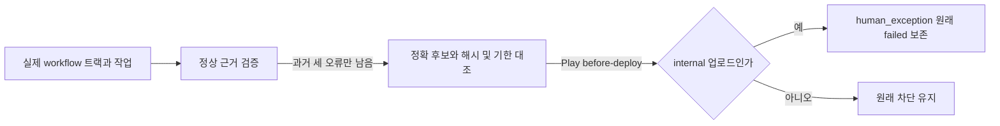

# 1.9.0 내부 테스트 업로드의 과거 검수 범위 예외

사용자가 이전 2회차 리뷰에서 남은 트랙 구분 문제의 수정 설계를 승인했다. [승인 기록](https://github.com/seorilabs/lizard-tycoon/issues/805#issuecomment-6261931273)과 [실행 티켓](https://github.com/seorilabs/.github/issues/279)을 사용한다. 기존 PR 280은 Draft로 보존하고 별도 PR에서 이전 후보 결속과 이번 제한을 함께 반영한다.

## 범위와 흐름

과거 세 오류와 후보, 해시, 만료는 [기존 설계](../2026-10-19-lizard-190-historical-coverage/design.md)를 유지한다. before-build는 빌드 근거로 사용하고 before-deploy의 Google Play 예외는 실제 목적 트랙 internal과 작업 upload가 모두 맞아야 한다. grant도 동일 조건을 명시한다. 코드의 허용값은 internal 업로드로 고정하므로 grant를 production이나 promote로 넓혀도 거절한다. 트랙 또는 작업 정보가 없는 호출은 예외를 받지 못한다.

중앙 Godot 업로드 workflow는 실제 inputs.track을 환경변수 RELEASE_TRACK으로 넘기고 검증 CLI의 --play-track과 --play-operation upload에 연결한다. 중앙 승격 workflow는 실제 inputs.to_track과 promote를 넘기므로 모든 승격은 과거 범위 예외를 받지 못한다. production 직접 업로드, alpha와 beta, 사용자 지정 트랙, 누락 입력도 거절한다. before-release와 web 및 service 공개 배포 차단을 유지한다. 정상 근거가 통과하는 기존 제품의 동작은 그대로다.

새 CLI 인자는 실제 작업 관측값이며 예외 ID나 생략 스위치가 아니다. 중앙에 검토한 정확 후보 grant 없이 일반 실패를 통과시키지 않는다. RN 업로드와 나머지 마켓 workflow는 바꾸지 않으며, 추가 정보 없는 Play 예외 요청은 차단된다. 앱의 제품 코드와 후보 SHA, SDK와 저장, 가격과 국가, 서명과 자격증명은 바꾸지 않는다.

## 인수조건과 검사

L1, dev 환경이다. 부정 사례가 현재 예외 코드에서 실제로 통과해 assertion이 실패하는 것을 먼저 보존했다. internal 업로드만 허용하며 production, alpha, beta, 사용자 지정 트랙, 트랙과 작업 누락, 모든 승격과 grant 확대는 거절한다. workflow의 실제 입력과 CLI 전달 연결, 정상 통과 결과 불변을 검사한다.

전체 npm test, pack:check, actionlint, diff 검사를 하고 실제 동일 원본의 세 마켓 원격 검증을 수행한다. 실제 Play CLI는 before-build, internal before-deploy 허용과 그 밖 트랙 및 승격 거절을 대조한다. 최종 HEAD CI와 새 설계에 대한 교차 리뷰를 완료한 뒤 병합한다. 기존 PR을 세 번째 리뷰로 이어 가지 않는다.

통과하면 기존 승인된 1.9.0 태그, 빌드와 테스트 채널 업로드를 이어간다. 추가 UI 회차, 기기 사용, 심사 제출과 공개는 이번 단계에 없다. 앱의 기존 L3 실행 근거를 중앙 L1 검사로 대체했다고 기록하지 않는다.

## 운영과 복구

기한 2026-10-26T03:59:05Z와 기존 원문 실패를 유지한다. grant를 제거하면 이후 새 검증은 원래 실패로 돌아간다. 이미 시작한 작업은 별도로 취소해야 한다. 신규 생략 입력, 새 자격증명, runner와 action 버전 변경은 없다. 중앙 main의 계약과 두 trusted workflow만 갱신한다.
