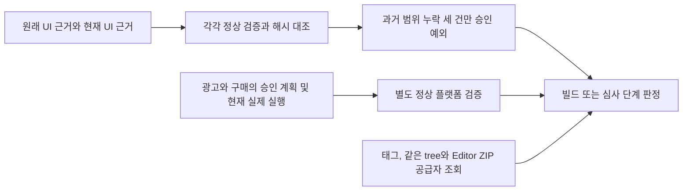

# Lizard Tycoon 1.9.1 App Store 심사 연결

상태: 승인. [사용자 승인](https://github.com/seorilabs/lizard-tycoon/issues/805#issuecomment-6265815627)은 [고정 제안](https://github.com/seorilabs/lizard-tycoon/blob/c71f7bf32d97686db39782521a31e9885ebddb70/docs/06-release/1.9.1/app-store-continuation-proposal.md)의 App Store 한 건이다. 이슈는 [286](https://github.com/seorilabs/.github/issues/286)이다. 원본 제안 SHA256은 `5ea2d94a28b2ddc6672b85579a4055a0304463f959b18eb79534ef41523d782d`다.

## 범위와 처리

`seorilabs/lizard-tycoon`, `v1.9.1`, 후보 `da203979846fdcf4fb5b591689d776d84fe14911`, App Store의 빌드 전, 내부 업로드 전, 심사 제출 전에만 적용한다. 일반 v1과 v2 판정, 기존1.9.0 grant와 은퇴한 Android 연결은 유지한다. 제품과 네이티브 설정, 기기 사용과 새 UI 회차는 포함하지 않는다.

새 전용 봉투는 `lizard-ios191-submission-continuation`이다. 원래 L3 문서의 실제 후보 `055aae4422610e279417f3f3a7d2b9007cb1754d`와 현재 후보의 실제 전체 CI를 각각 검증한다. 현재 문서는 UI와 홈 보정 계획을 함께 읽으므로 정상 병합 등급은L3다. 두 판정 모두 정확히 `FEATURE_COVERAGE ux-1`, `functional-4`, `ux-4`만 남아야 하며 원래 failed를 보존한다. 현재 문서의 과거 회차 전체는 원본과 바이트 의미 해시가 같아야 한다. 최종6차는 원래 SHA에서 기능과 UX 모두 통과해야 한다.

네이티브 문서는 기존 광고와 구매 계획을 승인 커밋 `55ac7b0c78dc1051b2ae2bf63e4847e40904aee4`에서 읽고 같은 후보의 실제 CI를 사용한다. 이 문서에는 UI 과거 예외를 적용하지 않는다. 정상 검증이 요구하는 실제 SDK, 설정 지문, 독립 실행자와4개 시나리오를 그대로 검사한다. `before-release`는 현재 `platform-first rewarded-ads ios`에서 차단된다. 해당 실제 실행이 없는 상태를 빌드 가능과 구분한다.

## 결속과 실패

중앙 grant는 원래 UI, 현재 UI와 네이티브 문서의 고정 부분을 각각 SHA256으로 결속한다. 네이티브 고정 부분은 실제 SDK 기록(`native-development`, `nativeSdk.mode=real`)만 제외한다. 그 기록을 추가해도 모든 원본 계획, CI와 나머지 필드는 바뀔 수 없고 실제 SDK 기록 자체는 정상 v2 검사 전체를 통과해야 한다. 실행 후 근거를 추가할 수 있도록 한 것이며 미실행·실패·대역 SDK의 면제가 아니다.

현재 후보와 Editor 작성자 `001a8d9bec627c3d73ac8d258e0fb733202a38db`의 Git tree `cd0ea63658ee2026c87088c169d5cb7cebf67878`, v1.9.1 Release417105241의 ZIP655801246과 SHA256 `920b3c845d4ed0e0dea79f0a386e0e737deefbda18f14b9d826724e9167a249d`를 공급자에서 읽는다. 실제 annotated tag와 receipt의 소스도 같아야 한다. raw 원본의 SHA를 바꾸거나 새 Editor 실행을 주장하지 않는다.

다른 앱, 후보, 마켓과 태그, 추가 오류, 근거 변조, 중복·누락 grant, 만료와 공급자 조회 실패는 차단한다. 현재 후보의 일반 v2 문서로 전용 검사를 우회할 수 없다. 기존 만료 `2026-10-26T03:59:05Z`를 늘리지 않는다. 새 CLI 면제 인자는 없다.

## 검증과 운영

중앙 변경 등급은L1, 개발 환경이다. 허용 단계, 정상 SDK4개 누락과 잘못된 런타임·설정·출처, 과거 실패 보존, 태그와 ZIP 조회, 다른 경로 보존을 테스트한다. 전체 중앙 테스트, package검사와 Actions lint, 읽기 전용 Claude 교차 리뷰 및 CI를 통과한 뒤 병합한다.

기존 Xcode Cloud 훅은 태그와 빌드 번호를 검사하지만 현재 중앙 근거 CLI를 직접 호출하지 않는다. 새 전용 재사용 workflow와 앱의 thin 수동 caller로 해당 앱의 `contents: read` 토큰에서 같은 마켓·후보의 검증을 수행한다. 이 workflow는 검증만 하며 빌드·업로드·제출을 시작하지 않는다. 정상 SDK가 미실행인 `before-release`의 실패도 그대로 보존한다. 실제 Cloud 빌드는 별도 `before-build` 통과 뒤 정확한 태그로 시작한다.

실제 SDK를 쓰는 데 기기가 필요하면 별도 소명과 승인을 먼저 받는다. 실제 빌드, TestFlight 처리, 마켓 자료와 정책 검수, `before-release` 통과 뒤에만 심사를 접수한다. 심사 접수 후 이 후보 grant, 전용 코드와 검증 workflow 및 caller를 제거하고 원래 실패와 실행 원장은 보존한다. 만료도 같은 제거 조건이다.
