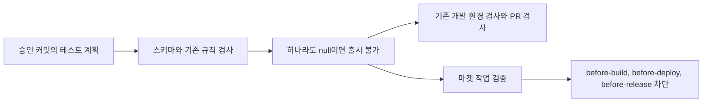

# 배포 없는 테스트 계획

- 설계 ID: `2026-10-23-no-release-plans`, v1
- 상태: 구체 설계 커밋에 대한 사람 검토 대기
- 기준: `1f3780179c7d1d5fb60a97b9688f2076f22e5205`
- 요청 근거: Lizard Tycoon 열린 이슈 27건 처리 계획. 개발 환경 검증과 PR 병합만 포함하고 마켓 빌드, 업로드, 제출, 공개와 기기 사용은 제외한다.
- 이 문서는 승인 자체가 아니다. 승인자는 대화의 사용자이며 승인 시 문서 커밋과 근거를 구현 PR에 연결한다.

## 목적과 범위

현행 `contracts/test-plan.schema.json`은 출시 객체만 받는다. `scripts/release/test-plan.mjs`의 병합은 모든 계획의 `release.markets`를 직접 읽는다. 개발만 승인한 작업을 가짜 출시 객체로 표현하지 않도록 명시적인 `release: null`을 추가한다.

| 입력 | 병합 결과 | 허용 |
|---|---|---|
| 기존 출시 객체만 | 기존 마켓 합집합, 가장 이른 끝 지점, 최소 비율 | 기존 승인 범위 유지 |
| 한 계획이라도 `release: null` | `releaseAllowed: false`, `markets: []`, `until: null`, `rollout: null` | 개발 검사와 PR 병합 |
| `release` 생략, 빈 객체 또는 잘못된 값 | 계획 오류 | 실행 불가 |

## 흐름과 책임

- 스키마는 기존 객체 정의와 필수 `release` 필드를 유지하고 null만 추가한다. 기존 객체의 `until` 생략 시 `public`, `rollout` 생략 시 1은 그대로다.
- 계획 병합은 출시 허용 여부를 명시적으로 계산한다. 다른 계획의 출시 승인이 null을 덮지 못하며 입력 순서에 영향받지 않는다. 등급, 기능, 환경, 하한 조정의 기존 병합 규칙은 유지한다.
- `testPlanProblems`의 `platformValidation` 시장 참조도 null을 처리한다. null 계획의 실제 SDK 개발 검수는 출시 승인을 만들지 않는다. 마켓이 없는 계획에 마켓 검수 항목을 적는 경우는 명시적 계획 오류로 반환한다.
- `verify-development-evidence.mjs`는 기존 승인 커밋 조회와 근거 검사를 유지하고 세 phase 모두 `RELEASE_NOT_AUTHORIZED development-only`로 차단한다. web과 service, 테스트 채널도 같다. 이는 마켓 작업 진입용 검증기의 차단이며 로컬 테스트와 PR 정적 검사에 가짜 출시 근거를 요구하지 않는다.
- workflow와 업로더의 gate 호출을 우회하거나 새 허용 옵션을 추가하지 않는다.
- 제품 화면, 저장 형식, 자격증명과 기기 동작은 변경하지 않는다.

## 검증 계획

조직 계약과 검증기만 바뀌므로 제품 기능 목록과 제품 실행 근거를 만들지 않는다. 중앙 개발 문서의 문서·정책 작업 규칙을 따르며 서비스 런타임의 Node 테스트로 검증한다. 예제에는 별도 `test-plan.development-only.example.json`을 추가한다.

| 조건 | 실패를 먼저 확인할 테스트 | 통과 기준 |
|---|---|---|
| NREL-1 | 스키마 null 허용, release 생략 거부 | null만 새로 허용, 기존 객체·기본값 유지 |
| NREL-2 | null 단독, 객체와 null의 양쪽 순서, 여러 객체와 null | 하나라도 null이면 출시 불가, 나머지 병합 결과 유지 |
| NREL-3 | 각 phase와 각 target의 검증기 호출 | 정상 개발 실행 근거가 있어도 마켓 작업 차단 |
| NREL-4 | null과 platformValidation | 예외 없이 명시적 문제 반환 |
| NREL-5 | 기존 출시 객체의 전체 테스트 | 기존 승인·등급·회귀·CI·출시 검증 유지 |
| NREL-6 | CLI 통합과 workflow 소비자 테스트 | null 계획이 실제 CLI 경로에서도 차단 |

요구사항에 의한 실패 확인 후 최소 구현, 관련 Node 테스트, `npm test`, `npm run pack:check`, `git diff --check`를 실행한다. 최종 코드 커밋에서 로컬 MiniMax 리뷰를 수행하고 수용한 결함을 수정한다. 한국어 Ready PR의 필수 검사와 미해결 thread를 확인하고 squash 병합한다.

## 문서와 적용, 복구

`contracts/development-workflow.yaml`, 실행 문서의 출시 필드·병합·단계별 검사·승인 뒤 진행 설명, 개발 전용 예제를 함께 맞춘다. 기존 승인 계획은 바꾸지 않는다. Lizard Tycoon의 개발 전용 계획은 이 선행 변경이 병합된 뒤 중앙 스키마로 검사한다.

나중에 출시할 때는 `release: null`을 객체로 고친 설계와 테스트 계획의 새 정확한 커밋을 별도로 승인받는다. 과거 출시 객체를 끌어와 null을 무효화하지 않는다. 문제가 있으면 코드와 계약을 함께 되돌리는 PR로 복구하고 null 계획은 미지원 상태로 차단한다. 출시 허용으로 대체하지 않는다.
