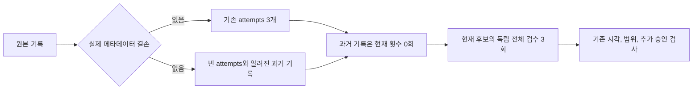

# 메타데이터가 있는 과거 검수 기록 보존

승인 근거는 2026-10-30 사용자의 추가 검수와 중앙 기록 형식 수정 승인이다. 승인 관측 시각은 `2026-10-30T07:06:54Z`이며 원래 발신 시각을 추정하지 않는다. 승인안은 Backoffice PR #559의 후보 `66269955d731ee017a53b7b237e2aaf97b29f8b8`에 대해 과거 실패와 미완료를 보존하고 새 4~6회 검수를 수행하는 범위를 설명한다. 제품 후보와 중앙 자율 실행기의 권한은 바꾸지 않는다.

## 문제와 입력

현재 `reviewHistoryRecovery`는 최초 3회의 실제 메타데이터 결손을 필수로 요구한다. 메타데이터가 모두 있는 초기 중단, 실패와 통과 회차를 같은 형식의 과거 기록으로 보존할 수 없다. 알려진 SHA와 시각을 null로 낮추거나 이전 후보를 현재 후보로 바꿔 기록할 수 없다.

`attempts`는 기존의 결손 3개 또는 빈 배열만 허용한다. 빈 배열이면 `completedRounds`나 `interruptedRounds`에 실제 기록이 있어야 한다. 중단 기록의 원래 판정, 실제 범위와 해시는 그대로 보존한다. 모든 과거 기록과 현재 회차는 실제 번호를 1부터 끊김 없이 이어야 한다.

알려진 최초 1~3회는 원래 설계 승인 범위다. 과거 4회 이후에는 그 당시 계획 전의 추가 승인을 요구하며, 실제 최초 3회가 끝난 뒤의 승인이어야 한다. 새로운 추가 회차는 마지막 과거 기록 이후이면서 자기 계획 전에 승인받아야 한다. 나중 승인으로 과거 추가 회차를 소급 승인할 수 없다.

현재 후보는 최소 3개의 완전한 독립 전체 검수가 필요하다. SHA, 계획과 실행 시각, 168시간, 전체 기능, 독립성, 마지막 통과, 추가 승인 상한과 마켓 검사를 유지한다. 과거 메타데이터 결손 모드, 정상 v2, v1과 개별 예외의 기존 의미는 유지한다.

## 변경과 적용

범위는 개발 근거 스키마, 검증기, 개발 계약의 해당 설명과 스키마, 실행 문서와 관련 테스트다. 데이터 이전, 제품 UI, MCP 설정, 기기와 마켓 작업은 없다. 기존 필드를 확장하며 새 계정이나 권한을 만들지 않는다. 버전 영향은 minor다. 중앙 PR의 필수 검사와 MiniMax 리뷰 후 squash 병합한다. Backoffice는 새 중앙 검증기를 사용하고 실제 새 검수 3회가 끝난 뒤 검증을 실행한다.

다른 입력 구조를 새로 추가하는 방식도 검토했다. 기존 과거 기록의 해시와 중단 의미를 재사용하고 결손이 없다는 사실을 빈 배열로 드러내는 편이 중복 판정을 줄인다. 빈 배열만으로 검사를 생략할 수 없도록 실제 과거 기록을 필수로 한다. 되돌릴 때는 코드와 스키마를 함께 되돌리고 새 형식의 원본은 보존한다. 해당 입력은 다시 차단되는 상태로 보고한다.

## 인수조건과 검증

- KH1: 알려진 초기 중단, 실패와 통과를 보존하고 승인된 현재 4~6회가 통과한다. 원본 객체를 바꾸지 않는다.
- KH2: 빈 이력, 잘린 결손 attempts, 누락과 중복 번호, 잘못된 시각, 원본 해시와 해결 근거 누락을 거부한다.
- KH3: 현재 2회, 다른 후보, 범위 누락, 만료, 같은 구현자, 추가 승인 누락과 소급 승인을 거부한다.
- KH4: 기존 결손 복구, 과거 추가 회차와 정상 입력의 회귀를 유지한다.

L1 개발 환경의 CLI 계약 변경이다. 실제 서비스나 앱 검수로 꾸미지 않고 합성 fixture임을 표시한다. 신규 허용 입력의 거부를 먼저 확인한 뒤 최소 코드로 통과시키고 전체 `npm test`, package 검사, actionlint와 diff 검사를 수행한다. 별도 제품 UI 3회는 Backoffice의 실제 실행 근거로 남긴다.
