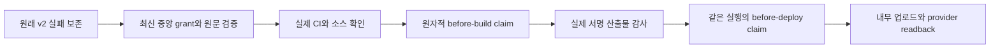

# Betta Atelier 첫 내부 배포 경로

관련 티켓은 #324다. 사용자가 제품 준비 커밋 `c13d6f80a25d53ed658f9ef3b639a09d970183a9`의 `docs/06-release/internal-upload-preparation.md`에 제안한 신규 등록·앱 전용 서명·private CI와 별도 중앙 예외의 준비·검증·두 내부 채널 도달을 승인했다. 기존 제품 L3 계획과 실패는 유지한다. 이 문서는 그 승인 범위를 실행하는 중앙 L1 개발 설계이며 새 게임 검수 회차가 아니다.

목표는 `seorilabs/betta-raising`, package와 bundle `com.seorilabs.bettaraising`의 정확한 후보 하나를 Play internal과 TestFlight 내부 그룹에서 확인할 수 있게 하는 것이다. 마켓별 grant는 한 target, 한 source, 한 tag, 한 설정 지문과 서명에 결속한다. 같은 후보에서 마켓별 빌드는 최대 2회, provider가 접수한 업로드는 최대 1회다. Apple의 빌드 번호는 실제 Cloud 번호를 사용하며 첫 번호와 바로 다음 번호만 허용한다. Android 번호는 중앙 원장과 annotated tag receipt를 따른다.

일반 v2 검증은 그대로 먼저 실행한다. 허용된 품질 미완료 오류의 정확한 집합이 일치할 때만 명시적 Betta ID를 평가한다. 미등록·회수·만료·다른 후보·schema 오류·새 CI 실패·권한 범위 오류·서명 불일치에는 예외를 적용하지 않는다. 성공 영수증도 `human_exception`, `productE2eStatus: blocked`, `nativeQaWaived: false`, `publicReleaseAllowed: false`를 유지한다. 최초 registry는 비활성이며 실제 source·CI·원장·provider·서명이 확정된 후 별도 검토로 grant를 등록한다.

| 책임 | 구현 |
|---|---|
| 범위·시간·원래 실패와 재시도 선택 | `betta-internal-bootstrap.mjs` |
| 최신 등록·회수와 원문, 원자적 claim | `betta-internal-grant-store.mjs` |
| 실제 Google run과 Cloud app·workflow·run·upload 상태 | `betta-internal-provider.mjs` |
| 원장·CI·v2·소스·산출물과 두 phase 연결 | `betta-internal-execution.mjs` |
| 실제 Apple 서명·profile·SDK·privacy 검사 | `betta-internal-apple-artifact.mjs` |
| 요청 이후 미접수의 정확한 provider 원본 증명 | `betta-internal-retry-proof.mjs` |

GitHub Release 자산 이름의 유일성으로 마켓·attempt·phase별 claim을 원자적으로 생성한다. 같은 producer와 같은 바이트의 재확인만 멱등으로 처리한다. 다른 producer의 동시 실행, 세 번째 빌드, artifact 변경, 시계 역행, 과거 claim의 설정 변경은 거부한다. 실제 run과 시장 상태도 함께 읽으므로 자산 파일 하나로 횟수를 초기화하지 못한다.

처리 중인 Apple `buildUploads`도 이미 접수된 것으로 취급한다. 요청을 시작한 뒤 목록이 비어 있다는 사실을 미접수로 해석하지 않는다. Google uploader 단계가 실제 `skipped`이거나, 원본 provider 로그의 정확한 해시와 실패 단계를 중앙에서 검토한 기록이 있을 때만 기존 upload intent 이후의 재시도를 허용한다. 불명 상태에서는 조회만 한다. reviewed retry registry도 처음에는 비어 있다. 실패·로그·접수 응답은 삭제하거나 성공으로 바꾸지 않는다.

Cloud custom script 사이에는 임시 파일 유지를 가정하지 않는다. post phase는 도구·중앙 verifier와 원본 SHA checkout을 독립 준비한다. before-build의 실제 작업트리 claim, 같은 provider run의 source·설정·attempt와 실제 signed app을 연결하며, 새 checkout을 빌드 후 작업트리 검사로 기록하지 않는다. Google은 실제 작업트리의 입력을 검사하고, 중앙 함수가 주입한 버전만 허용한다. SDK 입력의 정확한 해시와 좁은 네이티브 생성 경로 외의 숨은 소스는 거부한다.

기존 Spiritgate와 Lizard 예외는 변경하지 않는다. 두 마켓을 한 grant로 묶으면 설정 지문이 달라지므로 마켓별 ID로 분리한다. 새로운 범용 skip, 파일로 공급하는 grant, private macOS Actions, 기기 조작, 심사 제출과 공개는 허용하지 않는다. 첫 배포가 끝나면 grant를 회수한다. 후보·provider·서명이 바뀌면 이전 성공을 옮기지 않고 검토된 새 결속이 필요하다.

검증은 `test-plan.json`의 L1 dev다. 실제 JAR 서명을 사용한 AAB fixture, 원래 실패 보존, CLI·소비자·provider 관계·페이지 처리, 동시 claim, 재시도 불명·만료·다른 source·public 거부와 기존 전체 Node 회귀를 실행한다. 제품 SDK 준비와 Xcode 설정의 단위 검사는 제품 저장소에 둔다. 중앙 static CI·MiniMax Code와 독립 구현 검토를 완료한 뒤에만 활성화한다. 미실행 제품 UI·성능·기기 검수를 중앙 테스트로 대신하지 않는다.

운영 복구는 registry 회수로 fail-closed한다. 이미 올라간 내부 빌드·서명 자산·user save는 자동 삭제하지 않는다. 기존 runner·identity를 재사용하며 계정 권한·가격·예산·유료 플랜은 변경하지 않는다. 중앙 코드는 별도 비활성 PR, 실제 grant는 별도 PR로 검토하여 배포 권한과 코드 검토를 구분한다.

첫 빌드 전 추가 확인에서 중앙 다운로드 압축 파일과 Godot의 import 메타데이터가 소스 감사에 걸릴 수 있음을 확인했다. Betta 경로의 엔진 다운로드는 작업트리 밖에 두고, import 메타데이터는 추적된 정확한 입력과 Godot 캐시 경로만 참조할 때 허용한다. CSV 번역 출력도 추적된 CSV와 해당 메타데이터가 지목한 언어 파일로 한정한다. 실제 후보에서 생성한 456개 메타데이터·번역 파일을 별도 임시 checkout에 대조했다. 실행 소스 변경과 다른 리소스 참조는 계속 거부한다.
