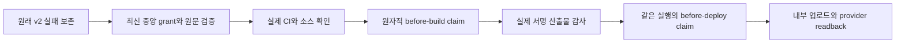

# Betta Atelier 첫 내부 배포 경로

관련 티켓은 #324다. 사용자가 제품 준비 커밋 `c13d6f80a25d53ed658f9ef3b639a09d970183a9`의 `docs/06-release/internal-upload-preparation.md`에 제안한 신규 등록·앱 전용 서명·private CI와 별도 중앙 예외의 준비·검증·두 내부 채널 도달을 승인했다. 기존 제품 L3 계획과 실패는 유지한다. 이 문서는 그 승인 범위를 실행하는 중앙 L1 개발 설계이며 새 게임 검수 회차가 아니다.

목표는 `seorilabs/betta-raising`, package와 bundle `com.seorilabs.bettaraising`의 정확한 후보 하나를 Play internal과 TestFlight 내부 그룹에서 확인할 수 있게 하는 것이다. 마켓별 grant는 한 target, 한 source, 한 tag, 한 설정 지문과 서명에 결속한다. 같은 후보에서 마켓별 빌드는 최대 2회, provider가 접수한 업로드는 최대 1회다. Apple의 빌드 번호는 실제 Cloud 번호를 사용하며 첫 번호와 바로 다음 번호만 허용한다. Android 번호는 중앙 원장과 annotated tag receipt를 따른다.

일반 v2 검증은 그대로 먼저 실행한다. 허용된 품질 미완료 오류의 정확한 집합이 일치할 때만 명시적 Betta ID를 평가한다. 미등록·회수·만료·다른 후보·schema 오류·새 CI 실패·권한 범위 오류·서명 불일치에는 예외를 적용하지 않는다. 성공 영수증도 `human_exception`, `productE2eStatus: blocked`, `nativeQaWaived: false`, `publicReleaseAllowed: false`를 유지한다. 최초 registry는 비활성이며 실제 source·CI·원장·provider·서명이 확정된 후 별도 검토로 grant를 등록한다.

| 책임 | 구현 |
|---|---|
| 범위·시간·원래 실패와 재시도 선택 | `betta-internal-bootstrap.mjs` |
| 최신 등록·회수와 원문, 원자적 claim | `betta-internal-grant-store.mjs` |
| 실제 Google run과 Cloud app·workflow·run·upload 상태 | `betta-internal-provider.mjs` |
| 원장·CI·v2·소스·산출물과 두 phase 연결 | `betta-internal-execution.mjs` |
| 실제 Apple 서명·profile·SDK·privacy 검사 | `betta-internal-apple-artifact.mjs` |
| 요청 이후 미접수의 정확한 provider 원본 증명 | `betta-internal-retry-proof.mjs` |

GitHub Release 자산 이름의 유일성으로 마켓·attempt·phase별 claim을 원자적으로 생성한다. 같은 producer와 같은 바이트의 재확인만 멱등으로 처리한다. 다른 producer의 동시 실행, 세 번째 빌드, artifact 변경, 시계 역행, 과거 claim의 설정 변경은 거부한다. 실제 run과 시장 상태도 함께 읽으므로 자산 파일 하나로 횟수를 초기화하지 못한다.

처리 중인 Apple `buildUploads`도 이미 접수된 것으로 취급한다. 요청을 시작한 뒤 목록이 비어 있다는 사실을 미접수로 해석하지 않는다. Google uploader 단계가 실제 `skipped`이거나, 원본 provider 로그의 정확한 해시와 실패 단계를 중앙에서 검토한 기록이 있을 때만 기존 upload intent 이후의 재시도를 허용한다. 불명 상태에서는 조회만 한다. reviewed retry registry도 처음에는 비어 있다. 실패·로그·접수 응답은 삭제하거나 성공으로 바꾸지 않는다.

Cloud custom script 사이에는 임시 파일 유지를 가정하지 않는다. post phase는 도구·중앙 verifier와 원본 SHA checkout을 독립 준비한다. before-build의 실제 작업트리 claim, 같은 provider run의 source·설정·attempt와 실제 signed app을 연결하며, 새 checkout을 빌드 후 작업트리 검사로 기록하지 않는다. Google은 실제 작업트리의 입력을 검사하고, 중앙 함수가 주입한 버전만 허용한다. SDK 입력의 정확한 해시와 좁은 네이티브 생성 경로 외의 숨은 소스는 거부한다.

기존 Spiritgate와 Lizard 예외는 변경하지 않는다. 두 마켓을 한 grant로 묶으면 설정 지문이 달라지므로 마켓별 ID로 분리한다. 새로운 범용 skip, 파일로 공급하는 grant, private macOS Actions, 기기 조작, 심사 제출과 공개는 허용하지 않는다. 첫 배포가 끝나면 grant를 회수한다. 후보·provider·서명이 바뀌면 이전 성공을 옮기지 않고 검토된 새 결속이 필요하다.

검증은 `test-plan.json`의 L1 dev다. 실제 JAR 서명을 사용한 AAB fixture, 원래 실패 보존, CLI·소비자·provider 관계·페이지 처리, 동시 claim, 재시도 불명·만료·다른 source·public 거부와 기존 전체 Node 회귀를 실행한다. 제품 SDK 준비와 Xcode 설정의 단위 검사는 제품 저장소에 둔다. 중앙 static CI·MiniMax Code와 독립 구현 검토를 완료한 뒤에만 활성화한다. 미실행 제품 UI·성능·기기 검수를 중앙 테스트로 대신하지 않는다.

운영 복구는 registry 회수로 fail-closed한다. 이미 올라간 내부 빌드·서명 자산·user save는 자동 삭제하지 않는다. 기존 runner·identity를 재사용하며 계정 권한·가격·예산·유료 플랜은 변경하지 않는다. 중앙 코드는 별도 비활성 PR, 실제 grant는 별도 PR로 검토하여 배포 권한과 코드 검토를 구분한다.

첫 빌드 전 추가 확인에서 중앙 다운로드 압축 파일과 Godot의 import 메타데이터가 소스 감사에 걸릴 수 있음을 확인했다. Betta 경로의 엔진 다운로드는 작업트리 밖에 두고, import 메타데이터는 추적된 정확한 입력과 Godot 캐시 경로만 참조할 때 허용한다. CSV 번역 출력도 추적된 CSV의 언어 파일과 검토한 정확한 digest로 한정한다. 실제 제품명과 렌더 설정으로 두 개의 독립된 새 import를 수행해 기존 생성물과 동일한 결과를 확인했다. 다른 제품명으로 실행해 digest가 달랐던 최초 비교도 원문을 보존했다. import 메타데이터의 source_file은 deps 섹션에서 정확히 한 번 선언되어야 한다. 실제 후보의 456개 메타데이터·번역 파일 대조도 수행했고 최초 실패와 수정 전 통과 근거를 별도로 보존한다. 실행 소스 변경과 다른 리소스 참조는 계속 거부한다.

후보 e4e9f67의 첫 CI는 headless 58여정을 통과한 뒤 XCursor 런타임 부재로 실제 렌더 시작에 실패했다. 원본 로그와 artifact를 보존하고 X11 의존성 및 긴 검사 전 실제 화면 실행 smoke를 추가한다. 이는 제품 소스 변경이나 제품 검수 통과 기록이 아니다.

서명 원본과 검사 영수증의 NAS 검증을 위해 Betta opt-in은 upload=true에서도 exact AAB artifact를 보존한다(#328). 검증 영수증은 명시한 다섯 텍스트 파일만 3일 보존하며 키·토큰·ADC·서명 디렉터리를 수집하지 않는다. 일반 소비자의 업로드 artifact 기본 조건은 유지한다. archive 자체를 서명 검사나 업로드 성공으로 기록하지 않는다.

첫 실제 Google 빌드 `43286867642`는 signed AAB export 뒤 `BETTA_UNTRACKED_SOURCE`에서 중단됐고 uploader는 skipped다. 실제 AAB의 `assetPackInstallTime/assets`와 고정 템플릿의 별도 asset-pack 모듈을 확인했다. 생성 허용 경로에 그 모듈의 `build`와 `src/main/assets`만 추가하고 build.gradle 등 입력은 digest 고정을 유지한다. Kotlin 플러그인이 적용된 두 Android 빌드 루트의 `.kotlin` 작업 캐시만 허용한다. 거부 메시지에는 JSON 이스케이프한 상대 경로를 넣어 다음 실패를 식별할 수 있게 한다.

실제 protobuf에는 MAIN/LAUNCHER가 `activity-alias`에 있고 portrait는 target activity에 있다. alias의 정확한 target을 해석해 방향을 검사하며, 누락·중복 target은 거부한다. 첫 실제 manifest의 원문·해시·run과 source를 작은 fixture로 보존하고 실제 signed AAB의 서명·certificate·SDK·portrait를 다시 검사한다.

검사기 revision 동안 이전 grant를 회수한다. 재결속은 별도 PR로 검토하며 기존 grant·claim·실패 로그를 보존한다. 새 grant ID의 claim 목록이 비어 있어도 같은 source의 실제 Google workflow runs 전체에서 순번을 계산한다. 이전 physical run의 terminal failure와 단 하나의 skipped uploader 또는 기존 reviewed 미접수 증거를 조회하고, 새 claim을 physical attempt 2로 기록한다. 미접수 불명·동시 실행·세 번째 run·GitHub rerun·claim 순번 불일치는 계속 거부한다. 최초 승인 시간·2회 빌드·1회 접수 한도는 늘리지 않는다.

## 같은 서명 파일의 업로드 전용 복구

두 번째 physical build `43292795874`는 export 중 runner communication lost로 끝났고 산출물은 없었다. 정확한 근본 원인은 확정하지 않았다. 후속 단계는 pending/null이며 skipped로 바꾸지 않는다. 두 빌드 한도는 소진됐으므로 세 번째 게임 빌드나 GHA rerun을 시작하지 않는다.

사용자가 승인한 C13은 signed AAB 검사 후 첫 내부 채널 도달과 필요한 pipeline/중앙 예외 준비를 포함한다. 같은 실제 signed AAB를 재사용하는 추가0build 경로는 제품·소스·버전·마켓·2build/1accepted 범위를 넓히지 않는다. 독립 범위 검토를 수행했다. 별도의 전용 workflow와 closed existingAabRecovery grant를 사용하고 정상 build/deploy CLI는 이 grant를 명시적으로 거부한다. 기존 r1은 회수한다. 별도 caller 브랜치의 전용 workflow 한 파일을 PR로 검토하고 병합하지 않는다. 검토·CI를 마친 고정 caller SHA에 annotated 운영 tag `betta-existing-aab-upload-0.1.0`를 붙여 실행한다. 게임PR2, 게임 소스와 원격/로컬main을 유지한다. artifactSourceSha는 bd78, uploaderCodeSha는 별도로 검토한 caller commit이다.

회수할 원본은 provider artifact13975726650, archive SHA1816e94e6473a9728a34efbcffb09f5930cb9037a898171a9eabf973c88975c5의 단일 betta-raising.aab다. 파일 SHA33ef4d1103c2ebea66c5f8d478b32de559b859747f2dc44faf2e241ba09d60eb와114,386,125바이트, package/code1/0.1.0/서명/SDK26·36/portrait를 검사한다. Godot·Gradle·prepare·export·sign은 실행하지 않는다. 최신main의 reviewed 코드/등록/회수와 최초 승인·만료·설정·99입력, tag/원장/CI/원래v2와9개 봉인 원본을 다시 검증한다. 과거 tracked 감사 뒤 untracked 중단은 유지한다. fresh original checkout과 immutable provider artifact를 대체 검증 범위로 기록하며 fullWorkingTreeAuditPassed:false다. 이를 과거 작업트리 전체 감사나 정상 QA 통과로 기록하지 않는다.

GitHub의 두 실제 source build와 before-build claim을 보존한다. 첫 uploader는 skipped이고 두 번째는 pending/null 및 runner lost annotation이어야 한다. 이전 두 grant의 회수, before-deploy intent 부재와 fresh Play empty를 확인한다. PodNotFound만으로 물리 worker 종료를 주장하지 않는다.

업로드 예산은 grantID와 무관한 repository/Release443379082/package/versionCode1의 `com.seorilabs.bettaraising.1.upload-intent.json` 한 개로 원자적으로 예약한다. 이어 정확한 두 이전 before-deploy asset 슬롯에 명시적 `betta-recovery-upload-fence`를 POST하고 전체 바이트를 다시 읽는다. 기존 정상 claim이 먼저면422로 recovery를 중단하고, fence가 먼저면 old producer의 claim POST가422·strict kind 실패로 끝나므로 그 uploader가 실행되지 않는다. fence는 정상 claim이 아니며 정상 schema에 허용하지 않는다. 두 슬롯과 global slot의 삭제·교체·rollback은 없다. 부분 fence, POST 응답 유실, 같은 producer 재호출과 모든422는 실제 업로드 없이 중단한다. 두 fence의 admission 차단 뒤 Play empty를 다시 확인하고 단 한 번 업로드한다. 예약 뒤 실패·접수 불명에는 자동 재시도가 없다. 예약이 전혀 없는 setup 실패는 이전 실행이 terminal일 때 검토·복구할 수 있다. 일반 rerun은 거부하며 아래 실제 실패 한 건만 닫힌 재시도로 허용한다.

검증은 closed schema·normal 경로 거부·immutable artifact tuple·두 빌드 이력·uploader provenance 분리·global/old fence 경합·부분 완료·응답 유실·동일 producer 재호출과 정상 schema의 fence 거부를 포함한다. 실제 archive 원본을 다운로드해 ZIPdigest와 파일명·크기·AABdigest를 사전 확인했다. 전체 Node·pack·actionlint·CI·필수 모델 리뷰와 별도 독립 구현 검토 뒤 활성화한다. 신규 범용 skip, 별도 key/계정권한·유료plan·기기·심사·공개는 추가하지 않는다.

운영 tag는 uploader 코드 선택에만 쓰고 제품 version/원장/source는 기존 v0.1.0/code1/bd78에서 읽는다. 실제 push run과 GITHUB_REF exact값, annotated tag object와 target commit, caller 파일hash를 모두 결속한다. 기존 deploy workflow를 세 번째 실행하거나 tag를 이동·삭제해 슬롯을 다시 열지 않는다. GitHub 재사용 workflow의 github context는 호출한 workflow의 context이므로 called workflow도 실제 caller의 push를 검사한다([공식 문서](https://docs.github.com/en/actions/reference/workflows-and-actions/reusing-workflow-configurations#github-context)). 첫 모델 리뷰는 외부 문서 요청 권한을 얻지 못한 뒤 제한시간으로 종료됐으며, 최종 운영 tag diff를 포함해 허용된 한 번만 재시도한다. 새 grant는 이 코드 PR과 분리해 실제 tuple이 확정된 뒤 등록한다.

## 업로드 예약 전 HTTP 415의 단일 재시도

실제 운영 tag의 run43309802883 attempt1은 ZIP GET에 octet-stream Accept를 보내 HTTP415로 중단됐다. job131502589080의 원문54,619바이트 SHA7b1c02bf73195e25ed1343f8e0cfabafdc0ce356106fd0511c16169cb215f1be와 실패 run/jobs를 보존한다. 이 지점은 global/fence 예약, Play readback, uploader 실행보다 앞이다. 이후 provider 조회에서도 세 슬롯이 없고 Play는 비어 있다. 원래9개 관측과 별도로 10번째 원본을 추가한다. 최초 grant14a91b319cf7d0bc7b9c31bef7bac838b35af3be03b615a8b0df748a1269b51f의 전체 바이트와 기존 verifier c55980f9 및 실제 reusable 실행6e7e9a40을 각각 보존한다.

GitHub Actions ZIP API의 첫 요청만 vnd.github+json Accept를 쓴다. Release asset의 octet-stream 기본과 redirect 시 인증 제거는 유지한다. 독립 범위 검토에 따라 같은 불변 caller9ff/tag와 run43309802883의 attempt2만 허용한다. 다른 run, attempt1 재사용, attempt3, 정상 native rerun, 예약 후 오류 재시도는 거부한다. 중앙 workflow가 원래 invocation ID를 새 preflight-r1 grant에 정확히 연결하며 원래 grant는 먼저 회수한다. 새 grant는 수정 코드 병합 뒤 별도 PR로 등록한다.

runtime은 /attempts/1의 실패와 정확한 job 원문 digest, 원래 grant 불변 바이트와 최초9개 관측, 기존 두 grant 및 직전 grant의 회수, global/fence 부재와 실제 빈 Play를 확인한다. 실제 producer는 github:43309802883:2로 기록한다. 전체 jobs rerun은 reusable @main을 새로 해석하므로 수정 grant 활성화 뒤 한 번만 호출한다. --failed rerun, tag 이동·재발행·추가 게임빌드·원장 변경·접수 예산 초기화는 하지 않는다. 기존2native/1accepted와 C13 최초 승인·만료·QA blocked·fullWorkingTreeAuditPassed:false는 그대로다.
