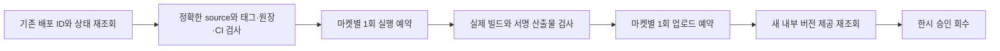

# Betta Atelier 0.1.2 내부 업데이트 허용안

사용자가 Care 수정본을 Android 내부 테스트와 TestFlight에 반영하라고 지시했다. 제품 기준은479d9c7이며 출시 연결을 준비한305ba6a의 실제 렌더40조건400시나리오가 통과했다. 출시 노트는 한·영으로 준비했고 원장 dry-run은 v0.1.2 / Android versionCode3을 제시했다. 태그·native 빌드·업로드는 실행하지 않았다.

현재 중앙 경로는 첫 배포 전용이다. `scripts/release/betta-internal-provider.mjs`의 `observeBettaProvider`는 Play에 빌드가 있으면 `BETTA_MARKET_ALREADY_HAS_BUILD`, Apple에 빌드나 upload가 있으면 `BETTA_MARKET_ALREADY_HAS_UPLOAD`를 반환한다. 현재 Play internal에는0.1.0/code1 completed가 있고 TestFlight에는 build3 VALID가 있다. 따라서 새 grant 번호만 등록해도 업데이트할 수 없다. 기존 검사나 기존 빌드를 지워서 우회하지 않는다.

일반 경로도 원래 shared-aquarium L3/redesign 계획, SDK 계획과 현재 UI 계획을 유지한 상태에서 실제 검사했다. 두 마켓 모두 `THREE_UI_ROUNDS_REQUIRED`로 차단됐다. 이전 미완료 설계를 빼거나 baseline을 옮겨 통과로 만들지 않는다. 이번 단일 내부 업데이트 승인도 원래 QA 실패를 정상 제품 QA 통과로 바꾸지 않는다.

## 승인받을 변경

기존 첫 배포 분기는 그대로 두고, 등록된 정확한 이전 배포를 보존하는 **단일 내부 업데이트 경로**를 중앙에 추가한다. 운영 설정의 정본은 기존 중앙 API와 불변 ConfigRevision을 유지한다. 새로운 앱별 운영 JSON이나 별도 가격·서명 정본을 만들지 않는다. 새 예외는 변경 가능한 운영 설정이 아닌 검토한 source/태그/provider 관측에 고정한 한시 승인으로 취급한다.

| 항목 | 고정할 범위 |
|---|---|
| 제품 |479d9c7의 게임 코드와 UI. 이후 소비자·출시 연결만 수정하고 최종 SHA를 다시 검증 |
| 마켓 |package/bundle com.seorilabs.bettaraising, Play 계정7593567020638200144, Apple app6834215464 |
| 이전 배포 |Play code1, Apple0.1.1/build3. 실행 직전 실제 IDs·digest·상태를 다시 읽어 승인 원본으로 보존 |
| 새 배포 |v0.1.2, 원장 발급 Android code3, Apple의 실제 다음 build번호(현재 기대4) |
| 상한 |마켓마다 새 native1회, 접수1회. 이전 Android2/Apple3회 기록을 포함한 누적 native 상한은 Android3/Apple4이며 누적 접수는 마켓마다2회. 재시도하지 않음 |
| 만료 |기존2026-11-19T15:35:59Z를 연장하지 않음 |
| 서명·권한 |기존 등록 publisher, 팀·인증서·프로필 재사용. 새 키·역할·유료 플랜·가격 없음 |
| 끝점 |Play internal completed와 TestFlight VALID/내부 그룹 제공. 외부 TestFlight·심사·공개·기기 조작·게임 main 반영 없음 |
| 기존 QA |기존 독립 UI·성능·네이티브 미완료와 실패는 유지. 정상 제품 QA 통과·nativeQaWaived로 표시하지 않음 |

이전 배포 목록에서 고정한 과거 항목만 허용한다. 새 목표 버전이 이미 있거나 미등록 항목·접수 불명·source/설정/서명 차이·동시 실행·추가 run이 있으면 중단한다. 실제 producer/claim/업로드 예약을 조회하고 새 grantID로 이력을 초기화하지 않는다. 단일 native-start intent와 upload intent는 중앙의 원자적 저장으로 보존한다. 이전 빌드를 삭제하거나 기존 first-only 검사를 느슨하게 만들지 않는다.

코드와 비활성 경로를 먼저 검토·테스트한 뒤, 실제 최종 source/태그/CI/provider tuple을 별도로 검토해 활성화한다. consumer는 검토한 authority revision과 작업 폴더를 사용한다. 이전 Cloud의 post-hook npm EUSAGE는 원문을 보존하고, 동일 설치 명령이 현재 로컬에서는 성공했다는 사실과 구분한다. 필요한 소비자 의존성 설치/검사 경로 수정도 이 범위에서 검증하되 원인을 확인하지 않고 해결됐다고 하지 않는다.

## 검증과 중단

L1/dev로 기존 first-only 경로 전체 회귀와 신규 업데이트 경로를 검사한다. 유효한 기존 배포+새 버전, 예상 밖 기존/신규 버전, source/원장/CI/서명 불일치, 정상 UI QA 차단 유지, 빈·중복·동시·오래된 예약, 물리 run과 claim 불일치, 접수 불명,1회 소진을 포함한다. 실제 빌드·업로드 전에 중앙 검증기를 실행하며 실패를 skip하지 않는다. 마켓끼리 성공을 대신하지 않는다. 코드·활성 승인을 별도 PR로 검토하고 모든 실제 산출물은 NAS1dual에 크기/SHA-256 재읽기로 보관한다.

예상 추가 시간은 계약 구현·리뷰·검증과 두 마켓 빌드·처리를 합쳐 약60~90분이다. 외부 쿼터/처리 대기는 달라질 수 있다. 승인 전에는 이 계약을 구현·활성화하거나 새 native/업로드를 시작하지 않는다. 이번 문서는 승인 요청안이며 사람이 승인했다고 기록하지 않는다.
