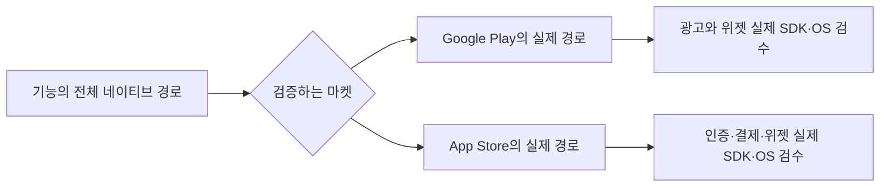

# 마켓별 네이티브 경로 분류 보완안

상태: 사람 검토 대기. 구현·검증기 배포 승인이 아니다.

## 문제와 기대 결과

My Little Parasite의 고정 후보 `2b213415001e6cc63b8028e9bb4ce22a49cce9d7`에서 Google Play `before-release`를 실행하면 account, purchase, refund, restore, ads, widget의 Android `platform-first`를 요구한다. 실제 Android 계정과 유료 판매는 제외됐고, 인증 네이티브 어댑터는 iOS에서만 구성된다. 현재 `features[].platformPaths`가 모든 마켓에 적용되어 iOS 경로까지 Android 필수 항목으로 계산하기 때문이다.

첫 출시, 활성 SDK, 회귀, 독립 검수와 실행 기한은 유지한다. 잘못 분류된 다른 마켓의 경로를 해당 마켓의 기기 실행으로 채우지 않는다.

## 계약과 구현 범위

1. 기능 목록 v2의 기능별·최상위에 선택 `platformPathsByMarket`를 추가한다. 키는 네이티브 연결이 있는 중앙 마켓 ID(`google-play`, `app-store`, `apps-in-toss`)이고 값은 기존 형식의 glob 배열이다. 명시한 맵은 모든 네이티브 마켓 키를 포함하며, 미채택 마켓은 빈 배열을 명시한다. 알 수 없는 키·잘못된 값·누락 키는 거절한다.
2. 기존 `platformPaths`는 전체 경로의 합집합으로 유지한다. 마켓 맵의 합집합과 일치해야 한다. 마켓 맵이 없으면 기존 배열을 모든 마켓에 적용하는 현재의 보수적 동작을 유지한다. 기존 소비자를 자동 전환하지 않는다.
3. `test-plan.mjs`의 영향 판정·첫 출시·새 기능·기준 태그와의 경로 합집합 및 실제 SDK 개발 검수 계획 판정에 같은 대상 마켓 선택을 사용한다. 기준 기능 목록을 읽을 수 없는 경우의 보수적 기본값도 유지한다. 맵을 지워 기존 하한을 피할 수 없게 이전·현재 경로를 함께 읽는다.
4. 관련 중앙 계약·실행 문서·예제·회귀 검사를 갱신한다. 특정 앱 SHA나 임시 허용 목록, 검증 생략 옵션, SDK 대역을 네이티브 통과로 바꾸는 경로를 추가하지 않는다.

기능의 실제 채택은 구현과 빌드에 맞게 작성하고 독립 검토한다. 경로 맵 자체만으로 실제 SDK 연결이나 마켓 승인·공개를 증명하지 않는다.

## 인수조건과 검증

| 조건 | 실제 검증 |
|---|---|
| C1 기존 입력 유지 | v1 및 맵 없는 v2의 기존 하한·오류·미실행 판정 회귀 |
| C2 마켓 구분 | 같은 인증·결제·광고·위젯 입력에서 Google Play와 App Store의 첫 출시 대상 비교 |
| C3 보수적 합집합 | 기준 태그의 경로 제거·맵 축소·새 플랫폼 기능·읽을 수 없는 기준 목록 |
| C4 잘못된 선언 거절 | 누락/추가 마켓, 잘못된 glob, 합집합 불일치·빈 맵 |
| C5 면제 추가 없음 | 활성 SDK의 실제 실행 부재, 대역 SDK, 다른 SHA·만료·저자 검수·UI 회차 결손의 기존 실패 유지 |

테스트 등급은 L1 개발 환경이다. 먼저 C2의 현재 잘못된 Android 요구를 회귀 검사로 고정하고 최소 수정한다. 중앙 전체 관련 Node 검사, 계약/schema 검사, 최종 HEAD의 로컬 코드 리뷰와 required check를 통과한 Ready PR로 병합한다. 마켓 빌드·제출이나 기기를 이 중앙 변경의 실행 근거로 만들지 않는다.

## 적용과 복구

My Little Parasite에서만 새 맵을 채택하는 별도 제품 변경을 수행한다. 기존 `v0.1.0` 태그와 실패 CI는 보존한다. 중앙 수정이 실패하면 병합하지 않고 기존 검증기의 차단을 유지한다. 이미 공개된 앱의 기존 근거와 마켓 상태를 고치지 않는다.

검토 대상은 이 문서와 같은 폴더의 테스트 계획, 제품 저장소의 `docs/design/2026-11-15-android-market-scope/design.md`다. 사람 승인 뒤에만 구현한다.
